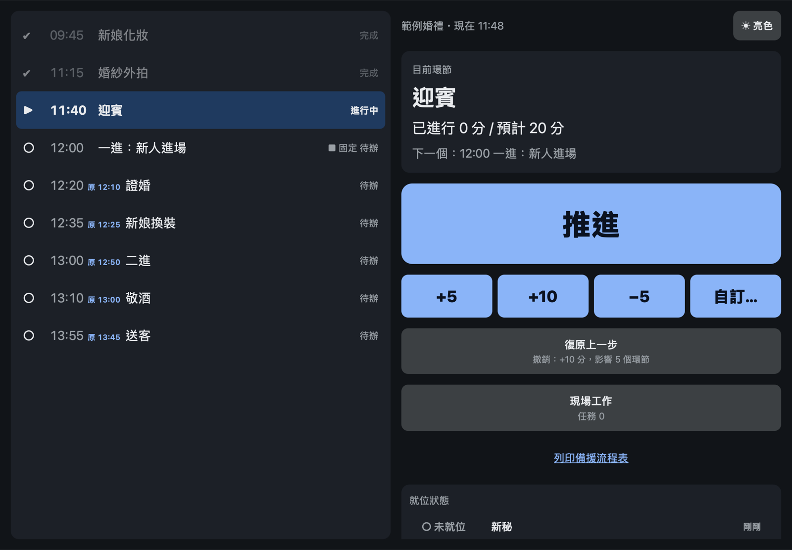
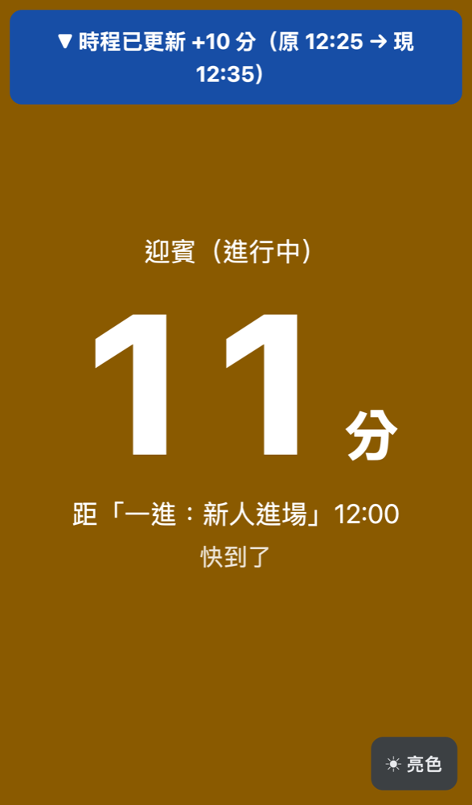
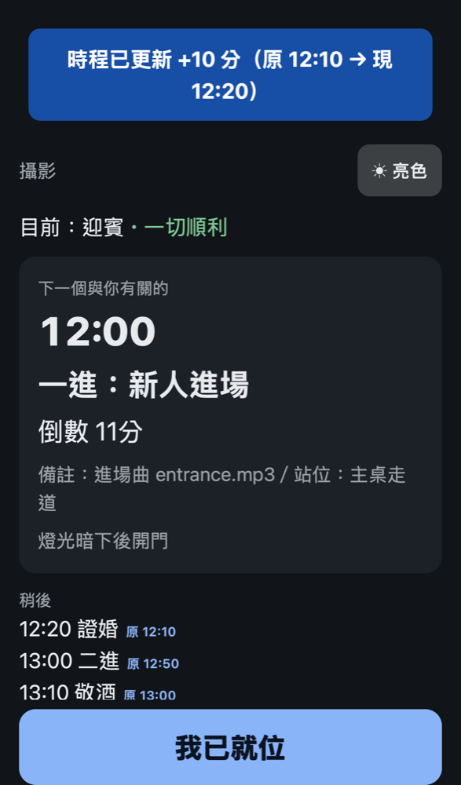

# BeThere

**一款即時婚禮當天時程與工作人員協調工具，當計畫有變時，讓所有人保持同步。**

> A live wedding day schedule and crew coordination app that keeps everyone in sync when plans change. (UI and docs are in Traditional Chinese.)



<p>
  
  
  
</p>

左起：新秘的大字倒數、攝影的「下一件事」、新人的平安儀表板。截圖用的是範例資料。

## 婚禮當天，時程一定會跑掉

通知所有人「時間改了」，現在全靠總召的腿和電話。

- **一個環節延誤，後面全部要挪**，但每個人手上的流程表是早上印的那份。
- **所有確認都壓在總召身上**：跑新娘房、打電話、喊對講機，只為了確認人到了沒、時間改了沒。
- **每個角色都很難看手機**：新秘雙手在忙、攝影手機在口袋、總召單手拿平板邊走邊講。資訊必須一眼看懂，或者完全不用碰。
- **現場環境很差**：宴會廳昏暗、吵雜、訊號不穩。斷線時畫面不能變成一片空白。
- **只有一次機會**：婚禮不能重來，系統壞掉時不能比沒有系統更糟。

BeThere 想做到的是：總召按下「延後 10 分」，新娘房裡的新秘抬頭一看，倒數已經變了，**沒有人需要跑去敲門**。

## 怎麼做到的

- **總召有一個遙控器**：平板上看得到整場進行到哪、誰到了；一個大按鈕推進到下一個環節，整體時間可以往前或往後挪，挪之前先試算。
- **工作人員點連結就能用**：每個人從 LINE 收到一條自己的連結，點開只看到與自己有關的下一件事和倒數。不用註冊，不用裝 App。
- **畫面依使用情況設計**：新秘的手機放在桌上，只有超大字倒數，螢幕不會暗；攝影、音控拿出來瞄兩秒，就知道下一件事與備註。
- **新人不被打擾**：只顯示「一切順利」或「延誤幾分」，不推播、不震動。
- **壞掉時有退路**：斷網時還看得到最後一次的流程表；隨時可以印出紙本備援。
- **現場分工**：領班回覆收到、機動組認領任務、迎賓查桌號與報到、禮金交接檢核。
- **婚顧公司**：成員收信登入，一起管理公司的多場婚禮。

## 技術亮點

- **一個執行檔**：Go 後端用 `go:embed` 把整個網頁包進去，部署只有一個檔案；只用標準庫的 `net/http`，不用框架。
- **SQLite 加持續備份**：WAL 模式；Litestream 隨時把資料複製到 Google Cloud Storage，主機的磁碟是空的時，開機自動從備份還原。
- **連結就是身分**：沒有帳號密碼，權限放在網址的 `#t=` 片段裡，片段不會隨網址送到伺服器，日誌與操作紀錄也不記；資料庫只存雜湊，撤銷、重發立即生效。
- **可以離線**：Preact 寫的網頁由 Service Worker 快取，本機保留最後一份流程表；以輪詢加內容 ETag 同步，資料沒變時不重傳。
- **時間平移只有一份邏輯**：平移與試算都在伺服器算，預覽和實際結果不會不一致。
- **一台最小的雲端主機**：Google Compute Engine 的 e2-micro，前面是 Caddy 自動申請 HTTPS；同時 3 場活動的負載測試通過。
- **測試**：每個使用者故事中能自動化的驗收條件都有對應的測試；14 條端對端路線用 Playwright 以 Safari 的引擎實際操作畫面，包含斷網、伺服器停擺、維護模式。

## 怎麼開發的

需求、設計、決定都先寫成文件（[docs/](docs/README.md)），再寫程式。程式主要和 Claude Code 協作完成：[`CLAUDE.md`](CLAUDE.md) 規定 AI 要遵守的規則，每次改動都要過三道品質關卡（單元測試、函式複雜度、突變測試），由 CI 把關，AI 不能修改關卡的設定。

## 在自己的電腦上執行

需要 Go 1.26 以上與 Node.js（含 npm）。

```bash
make build                                            # 打包網頁並建置，產生 build/bethere
BETHERE_INIT=1 ./build/bethere serve -db build/dev.db  # 第一次：建立新的資料庫並啟動
```

之後再啟動時拿掉 `BETHERE_INIT=1`（資料庫已存在時加了會拒絕啟動）。服務在 `http://127.0.0.1:8080`，`Ctrl+C` 停止。

建立一場活動：服務開著時，在另一個終端機產生邀請碼，再到瀏覽器建立。

```bash
./build/bethere create-invite -db build/dev.db
```

打開 `http://127.0.0.1:8080/new`，貼上邀請碼、填活動名稱與日期，按「建立活動」，再按「進入總召畫面」。接著照「婚前準備」新增角色、建立流程表、產生每個人的連結。

- 推進只有在活動日當天能按；活動日當天不能匯入流程表。想試當天的操作，日期填今天，在畫面上一筆一筆新增環節。
- 本機沒有設定寄信，婚顧公司成員的登入信寄不出去。

## 文件

從 [docs/README.md](docs/README.md) 開始：產品願景、使用者故事與驗收條件、資料模型、同步與離線、權限、畫面、API、架構、維運手冊，以及每個技術決定的理由。

## 狀態

婚禮當天要用的功能都已完成，正在找人實際試用。預定 2027 年第一次用在真正的婚禮上；之前會做一次完整彩排，沒通過就改用紙本加 LINE 群組。詳細的現況與風險見 [docs/status.md](docs/status.md)，每一版做了什麼見 [CHANGELOG.md](CHANGELOG.md)。

## 授權

[MIT](LICENSE)
