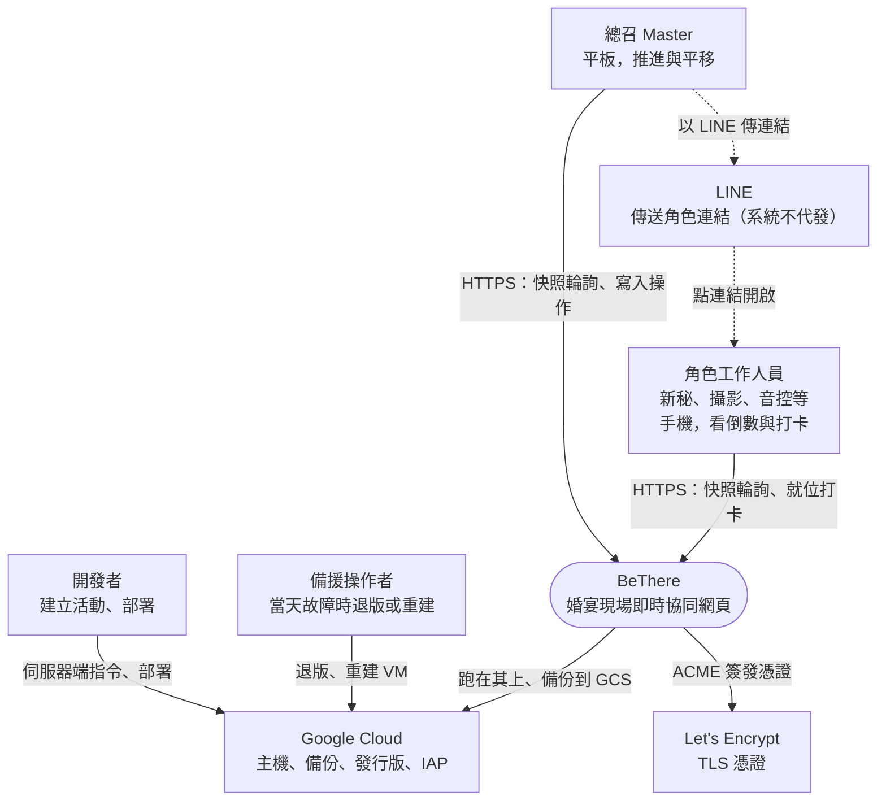
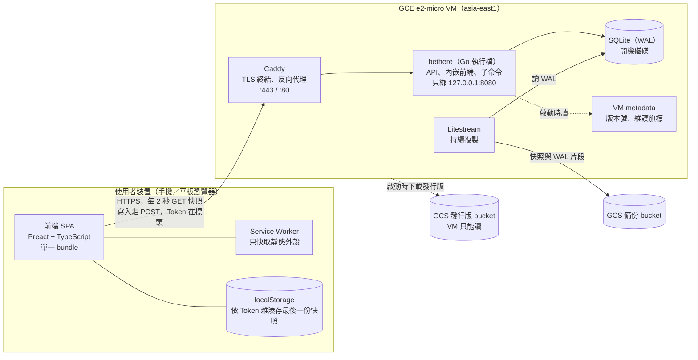
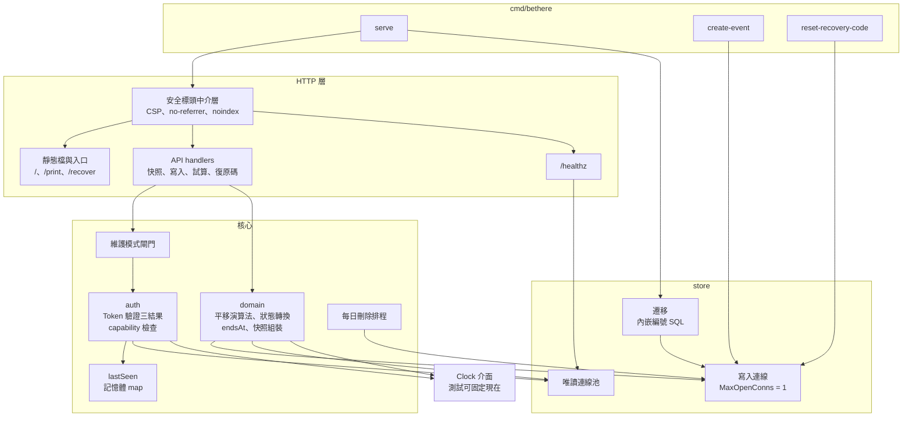
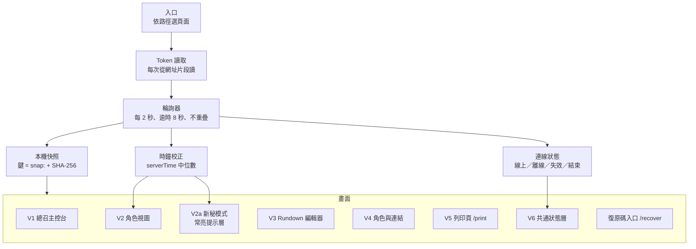
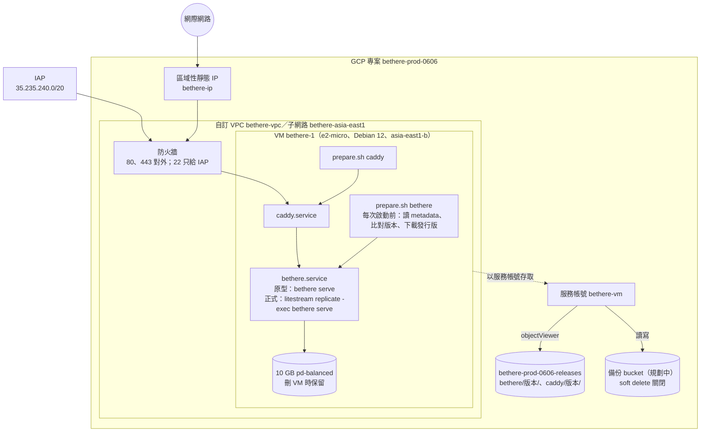

# 架構總覽 (Architecture Overview) — P0 範圍

> 從架構師的角度把各設計文件串起來：系統邊界、容器、元件、部署與品質目標。細節以 `docs/design/` 為準，取捨理由見 `docs/adr/`。
> 圖以 Mermaid 撰寫，GitHub 與多數編輯器可直接顯示。動態行為見 `runtime-views.md`，狀態與類別見 `behavior-models.md`。

---

## 1. 目標與限制

### 1.1 業務目標

婚宴當天，讓所有工作人員與廠商在對的時間出現在對的位置：

- 總召一鍵推進流程、一鍵平移後續時程。
- 每個角色只看到與自己有關的倒數與備註。
- 任何人都不需要註冊或安裝 App。

### 1.2 限制

| 限制 | 內容 | 影響的決定 |
| --- | --- | --- |
| 期限 | 第一場使用 2027/06/06，一人開發 | 架構越少零件越好（ADR-0008、ADR-0009） |
| 當天無人維運 | 開發者本人就是新人 | 失效安全（ADR-0012）、備援操作者（ADR-0013） |
| 自費 | 越省越好 | 單一 e2-micro，每月約 US$11～12（ADR-0009） |
| 使用者 | 10～30 人、當天才第一次用，多從 LINE 點連結 | 免註冊連結（ADR-0002）、LINE 受限環境（ADR-0010） |
| 現場網路 | 地下室、會場 Wi-Fi、iOS 背景暫停 | 輪詢（ADR-0004）、離線快取（ADR-0010） |
| 隱私 | 個資法；結束後要刪除 | 自動結束與 90 天刪除（ADR-0011） |

## 2. 品質目標

依重要性排序。每項以可驗證的情境表示。

| # | 品質 | 情境 | 目標 | 驗證方式 |
| --- | --- | --- | --- | --- |
| Q1 | 即時性 | 總召按下推進或平移 | 95% 的終端 3 秒內更新（E2） | `oha` 負載測試 + 實機往返（R4） |
| Q2 | 可用性（降級） | 伺服器或網路完全中斷 | 已開過頁面的裝置仍能唯讀顯示時程、倒數照跑；另有紙本 | 實機離線測試（R2）；婚前演練 |
| Q3 | 資料安全（失效安全） | 還原失敗、資料庫錯誤 | 任何失敗都表現為「離線」，不會讓裝置清掉快照 | 自動測試（ADR-0012） |
| Q4 | 易用性 | 廠商第一次收到 LINE 連結 | 點一下就能用，不需註冊；新秘雙手不空也看得到倒數 | 實機驗證（R1、R3） |
| Q5 | 正確性 | 平移遇到固定 Cue、排除勾選、負值 | 結果與 `data-model.md` 4.2 一致，可精確復原 | 表格驅動單元測試 |
| Q6 | 隱私 | 活動結束 | 連結立即失效；伺服器端所有副本 90 天內消失 | 第 85 天人工驗收（`tech-stack.md` 3.3） |
| Q7 | 可恢復性 | VM 或磁碟故障 | 備援操作者 15 分鐘內恢復 | 暫存專案演練（`tech-stack.md` 3.1） |

## 3. 系統情境（C4 第 1 層）

**範圍外**：賓客、推播、通訊錄撥號（P2）；婚顧公司的多租戶（C4）。

## 4. 容器（C4 第 2 層）

| 容器 | 技術 | 職責 | 決定 |
| --- | --- | --- | --- |
| 前端 SPA | Preact、Vite | 依路徑與快照角色顯示 V1～V6；倒數與時鐘校正；本機快照 | ADR-0008、ADR-0010 |
| Service Worker | Workbox `generateSW` | 預先快取外殼；`/api/` 一律不攔截 | ADR-0010 |
| Caddy | Caddy 2 | TLS、HTTP 轉 HTTPS、反向代理 | ADR-0009 |
| bethere | Go 標準庫 | API、Token 驗證、權限、領域邏輯、每日刪除排程、子命令 | ADR-0007、ADR-0008 |
| SQLite | `modernc.org/sqlite` | 唯一的資料儲存；讀寫分兩個連線池 | ADR-0009 |
| Litestream | Litestream | 持續備份到 GCS；開機時還原 | ADR-0009、ADR-0011 |

## 5. 元件（C4 第 3 層）

### 5.1 後端（`bethere` 執行檔）

| 元件 | 職責 | 依據 |
| --- | --- | --- |
| auth | 每個請求先驗 Token，回「無效／已結束／有效」；再依 Role 類型檢查 capability；不信任客戶端的角色資訊 | `access-control.md` 3.3、4、5 |
| 維護模式閘門 | metadata 維護旗標為 1 時，`/api/` 只放行 Master 與「換發 Master」 | ADR-0012 |
| domain | 純函式為主：平移與試算、狀態轉換與復原、`endsAt`、依角色組裝快照 | `data-model.md` 4；ADR-0006、ADR-0007 |
| store | 寫入一條連線（`_txlock=immediate`）、唯讀連線池；遷移只做向後相容新增 | `tech-stack.md` T3a、T4 |
| lastSeen | 驗證成功後更新，只存在記憶體 | `tech-stack.md` T7 |
| 每日刪除排程 | 刪除 `endsAt` 超過 80 天的活動 | ADR-0011 |
| 子命令 | 建立活動、重設復原碼；輸出只到終端機 | `tech-stack.md` T11 |

預定的目錄結構見 `tech-stack.md` 第 4 節。目前的 `internal/server/` 是實機驗證用的原型，只有 HTTP 層。

### 5.2 前端

## 6. 部署視圖

- 部署：`ops/gcp/release.sh` 上傳發行版 → `ops/gcp/deploy.sh <版本>` 改 metadata 並重啟服務。回退是同一個指令帶上一版。
- 重建：`ops/gcp/create-vm.sh` 在專案已有 VM 時拒絕執行，確保恰好一台。
- 備份 bucket 與 Litestream 尚未建置（正式實作時加入）；原型目前沒有資料庫。

## 7. 橫切關注

| 主題 | 做法 | 依據 |
| --- | --- | --- |
| 身分 | 每個角色一條帶 Token 的連結；復原碼救援 Master | ADR-0002、ADR-0003 |
| 授權 | 伺服器端 capability 表；快照在查詢層過濾 | `access-control.md` 4、5 |
| 時間 | 伺服器 UTC；`time/tzdata` 內嵌；客戶端以 `serverTime` 校正倒數 | `tech-stack.md` T12；`sync-and-offline.md` 4 |
| 一致性 | 寫入帶 `eventVersion`，過期拒絕；單一寫入連線 | ADR-0005 |
| 錯誤語意 | 只有確實查無 Token 才回「無效」；其他錯誤都是伺服器錯誤 | ADR-0012 |
| 安全標頭 | CSP 不允許 inline script 與第三方來源；`no-referrer`；`noindex`；API `no-store` | `tech-stack.md` T14 |
| 日誌 | `slog` JSON 到 stdout；不記錄請求標頭與本文（Token 與復原碼） | `tech-stack.md` T13 |
| 稽核 | 所有改變狀態的操作寫入 ActionLog | `data-model.md` ActionLog |
| 測試 | 領域表格驅動、API 以 `httptest` + 暫存 SQLite、前端 Vitest、負載 `oha`、實機清單 | `tech-stack.md` 第 4 節 |

## 8. 風險與技術債

| # | 風險 | 現況 | 處理 |
| --- | --- | --- | --- |
| K1 | Android 上 `#t=` 是否保留（R1） | iOS 全部成立；Android 未測 | 開始實作 Token 流程前請 Android 同事測；不成立時重審 ADR-0002 |
| K2 | 延遲預算沒有緩衝（Q1） | iOS 往返中位數 15～77 ms | 負載測試；必要時把輪詢縮到 1～1.5 秒 |
| K3 | 單一 VM 單點故障 | 刻意接受 | 離線快取 + 紙本 + 備援操作者 15 分鐘恢復 |
| K4 | 當天維運手冊仍是要求草案 | 未演練 | 寫成腳本，在暫存專案以備援操作者帳號演練，再抗辯審查 |
| K5 | 尚未找到備援操作者 | — | 找不到就明確接受只剩離線快取與紙本（ADR-0013） |
| K6 | 尚未購買正式網域 | 原型用 `sslip.io` | 發出任何連結前設定 |
| K7 | iOS 重開頁面後需點擊才能常亮 | 已實機確認 | V2a 常亮提示層（`screen-design.md` V2a） |
| K8 | iOS 對 7 天未互動網站清除資料 | 平台行為 | 活動前一天請所有人再開一次（`tech-stack.md` 3.2） |
