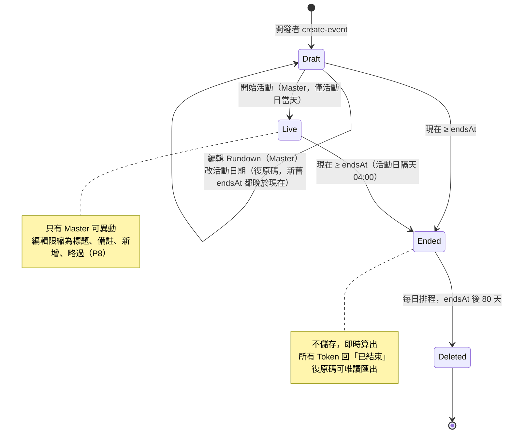
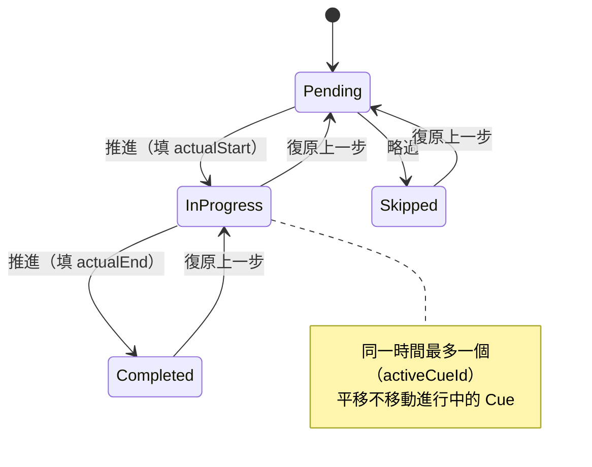
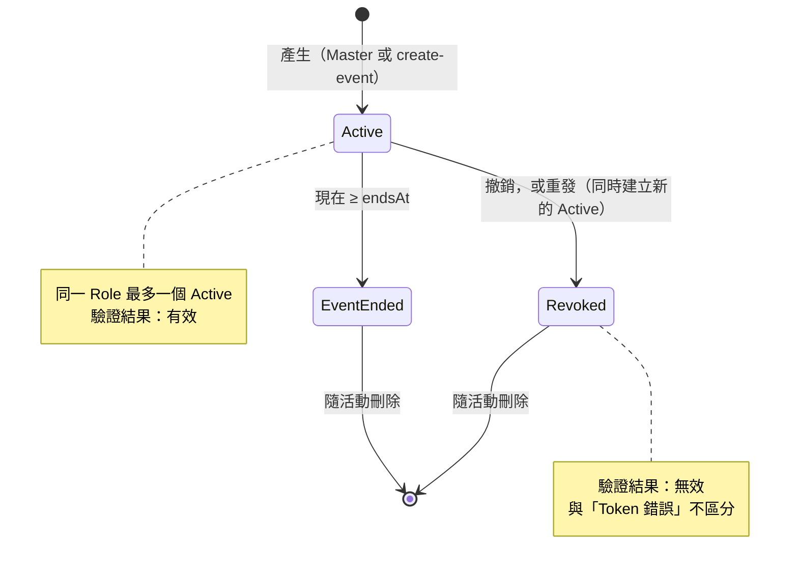
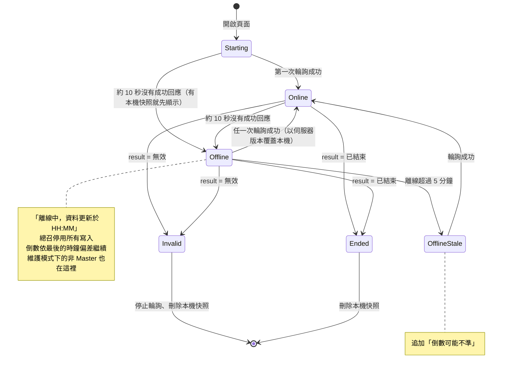
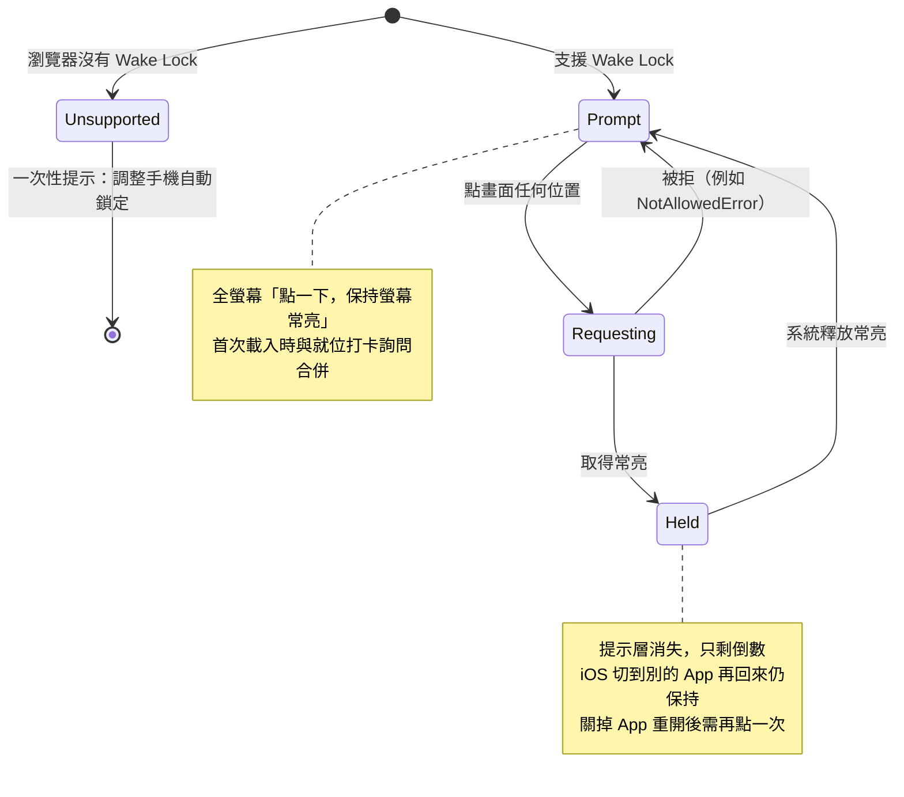
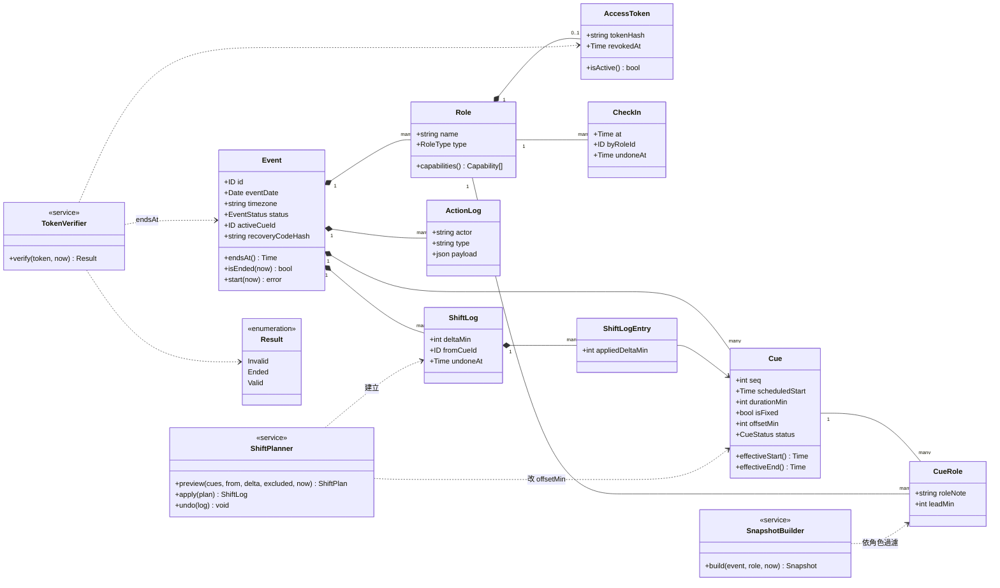

# 狀態與領域模型 (Behavior Models) — P0 範圍

> 以 UML 狀態圖與類別圖描述領域行為。欄位定義以 `data-model.md` 為準；這裡補上「誰能在什麼條件下改變狀態」與各類別的職責。

---

## 1. 活動（Event）生命週期

對應：`data-model.md` Event、M9；`access-control.md` 第 2 節；ADR-0011。

## 2. Cue 狀態

對應：`data-model.md` 4.1、M3、M7、M10。

- 主控台的「推進：完成並開始下一個」在同一筆交易內把目前 Cue 改為 Completed、下一個 Pending 改為 InProgress；復原時兩者一起回退（依 V1 按鈕語意推定，`data-model.md` 未明寫）。
- 只有 Pending 且非 Fixed 的 Cue 會被平移（`data-model.md` 4.2）。
- 略過可以用「復原上一步」回到 Pending（`data-model.md` M10，2026-10-21 確認）。

## 3. 角色連結（AccessToken）

對應：`access-control.md` 3.1、3.4；`data-model.md` AccessToken。

Master 的 Token 只能以復原碼換發，Master 連結本身不能重發 Master（P5）。

## 4. 客戶端連線狀態

對應：`sync-and-offline.md` 第 5、6 節；`access-control.md` 3.3；`screen-design.md` V6。

只有可解析且 `result` 明確為「無效」或「已結束」的回應會進入終止狀態；HTTP 401、403、5xx、逾時、會場 Wi-Fi 登入頁都只算離線。

## 5. 新秘模式的常亮提示層

對應：`screen-design.md` V2a（✎ 2026-10-21）；`tech-stack.md` 5.1、R3。

## 6. 領域類別圖

對應：`data-model.md` 第 2～4 節。只列與行為有關的欄位與操作；方法名稱是設計層級的示意，實作時以 Go 慣例命名。

| 服務 | 規則 | 測試重點 |
| --- | --- | --- |
| ShiftPlanner | `preview` 與 `apply` 用同一套計算；`apply` 是單一交易並使 `eventVersion + 1` | 固定 Cue、排除勾選、進行中不動、負值時排除已逾時並拒絕早於現在、Fixed 衝突只警告、復原精確 |
| SnapshotBuilder | 只含該角色可見的 Cue 與欄位；Master 帶完整 CueRole 與維護旗標 | 每種角色的鍵集合；Host 不含 Cue |
| TokenVerifier | 依序判斷無效 → 已結束 → 有效；儲存層錯誤回錯誤而非「無效」 | 撤銷、過期、時區邊界、資料庫錯誤 |
