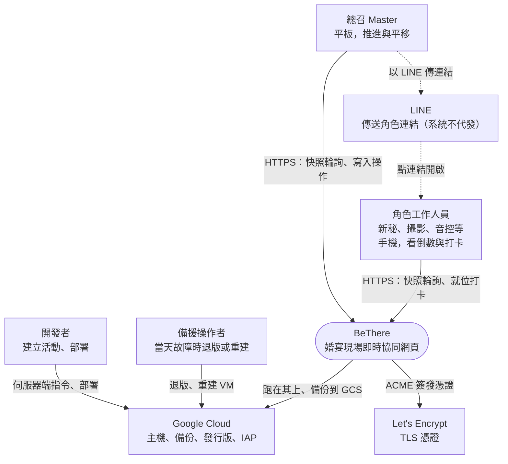
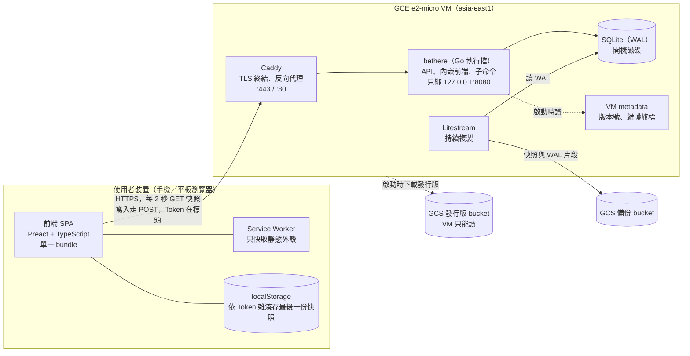
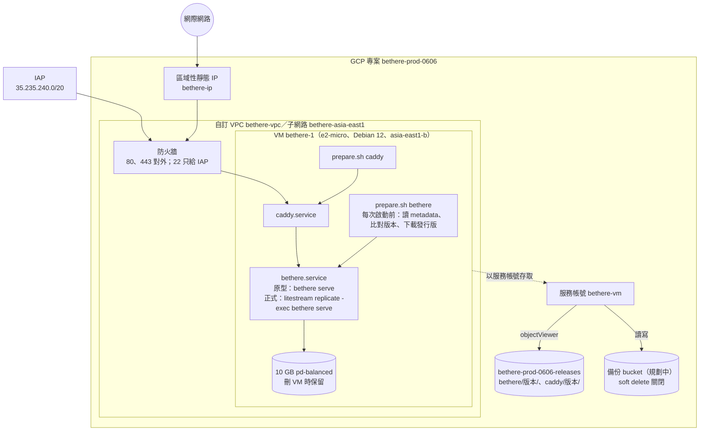

# 架構總覽 (Architecture Overview)

> 一頁看全貌：系統邊界、容器、部署與橫切關注。規則以 `design/` 為準，理由見 `adr/`，品質目標見 `requirements/scope.md` 的 NFR，風險見 `docs/README.md` 的 RISK。
> 流程圖與狀態圖放在它們說明的設計文件裡（ADR-0017）。

---

## 1. 目標與限制

### 1.1 業務目標

婚宴當天，讓所有工作人員與廠商在對的時間出現在對的位置：

- 總召一鍵推進流程、一鍵平移後續時程。
- 每個角色只看到與自己有關的倒數與備註。
- 任何人都不需要註冊或安裝 App。

### 1.2 限制

| 限制 | 內容 | 影響的決定 |
| --- | --- | --- |
| 期限 | 第一場使用 2027/06/06，一人開發 | 架構越少零件越好（ADR-0008、ADR-0009） |
| 當天無人維運 | 開發者本人就是新人 | 失效安全（ADR-0012）、備援操作者（ADR-0013） |
| 自費 | 越省越好 | 單一 e2-micro，每月約 US$11～12（ADR-0009） |
| 使用者 | 10～30 人、當天才第一次用，多從 LINE 點連結 | 免註冊連結（ADR-0002）、LINE 受限環境（ADR-0010） |
| 現場網路 | 地下室、會場 Wi-Fi、iOS 背景暫停 | 輪詢（ADR-0004）、離線快取（ADR-0010） |
| 隱私 | 個資法；結束後要刪除 | 自動結束與 90 天刪除（ADR-0011） |

## 2. 系統情境（C4 模型第 1 層）

**範圍外**：賓客、推播、通訊錄撥號（P2）；婚顧公司的多租戶（ADR-0016）。

## 3. 容器（C4 模型第 2 層）

| 容器 | 技術 | 職責 | 決定 |
| --- | --- | --- | --- |
| 前端 SPA | Preact、Vite | 依路徑與快照角色顯示各畫面（`screen-design.md`）；倒數與時鐘校正；本機快照 | ADR-0008、ADR-0010 |
| Service Worker | Workbox `generateSW` | 預先快取外殼；`/api/` 一律不攔截 | ADR-0010 |
| Caddy | Caddy 2 | TLS、HTTP 轉 HTTPS、反向代理 | ADR-0009 |
| bethere | Go 標準庫 | API、Token 驗證、權限、領域邏輯、每日刪除排程、子命令 | ADR-0007、ADR-0008 |
| SQLite | `modernc.org/sqlite` | 唯一的資料儲存；讀寫分兩個連線池 | ADR-0009 |
| Litestream | Litestream | 持續備份到 GCS；開機時還原 | ADR-0009、ADR-0011 |

## 4. 部署視圖

部署、回退與重建的程序見 `operations/runbook.md`。

## 5. 橫切關注

| 主題 | 做法 | 依據 |
| --- | --- | --- |
| 身分 | 每個角色一條帶 Token 的連結；復原碼救援 Master | ADR-0002、ADR-0003 |
| 授權 | 伺服器端 capability 表；快照在查詢層過濾 | `access-control.md` 4、5 |
| 時間 | 伺服器 UTC；`time/tzdata` 內嵌；客戶端以 `serverTime` 校正倒數 | `tech-stack.md` 2.1「時間」；`sync-and-offline.md` 第 4 節 |
| 一致性 | 寫入帶 `eventVersion`，過期拒絕；單一寫入連線 | ADR-0005 |
| 錯誤語意 | 只有確實查無 Token 才回「無效」；其他錯誤都是伺服器錯誤 | ADR-0012 |
| 安全標頭 | CSP 不允許 inline script 與第三方來源；`no-referrer`；`noindex`；API `no-store` | `tech-stack.md` 2.1「安全標頭」 |
| 日誌 | `slog` JSON 到 stdout；不記錄請求標頭與本文（Token 與復原碼） | `tech-stack.md` 2.1「日誌」 |
| 稽核 | 所有改變狀態的操作寫入 ActionLog | `data-model.md` ActionLog |
| 測試 | 領域表格驅動、API 以 `httptest` + 暫存 SQLite、前端 Vitest、負載 `oha`、實機清單 | `tech-stack.md` 第 4 節 |
