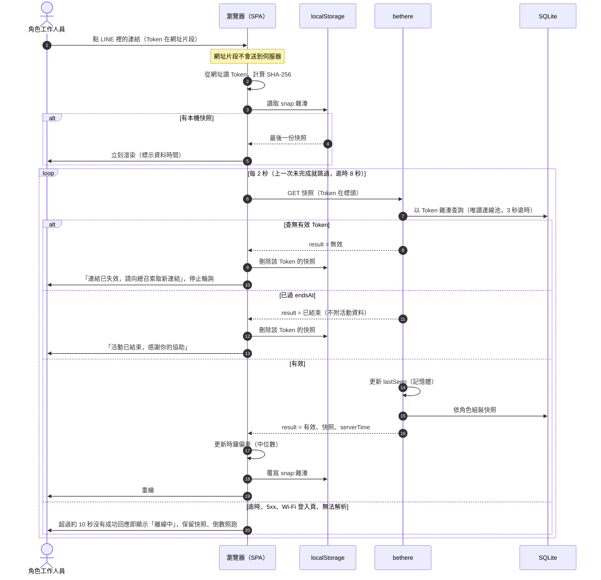
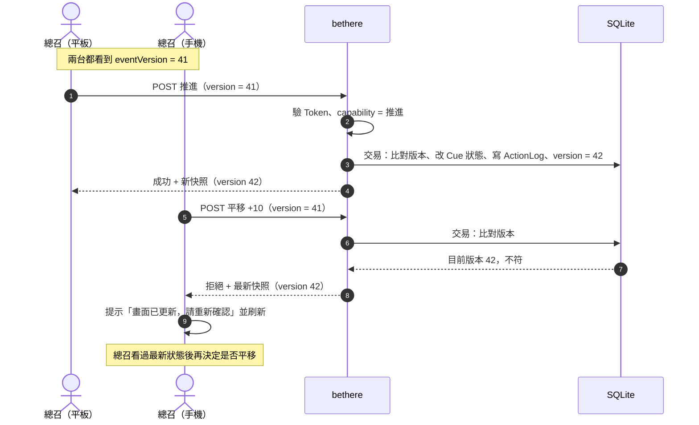
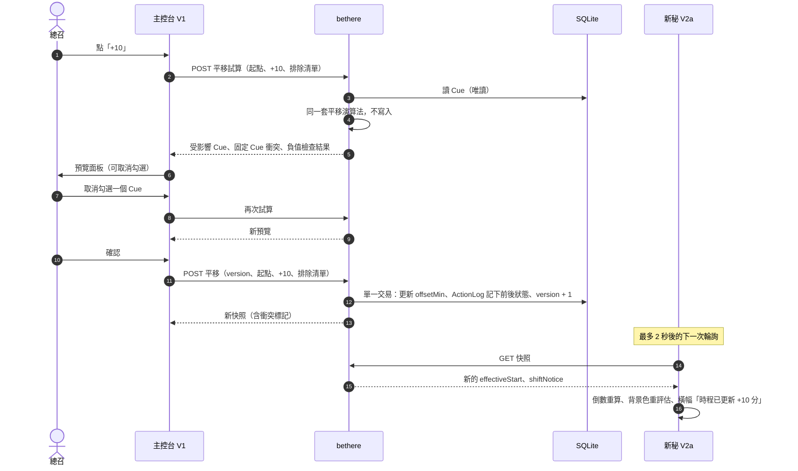
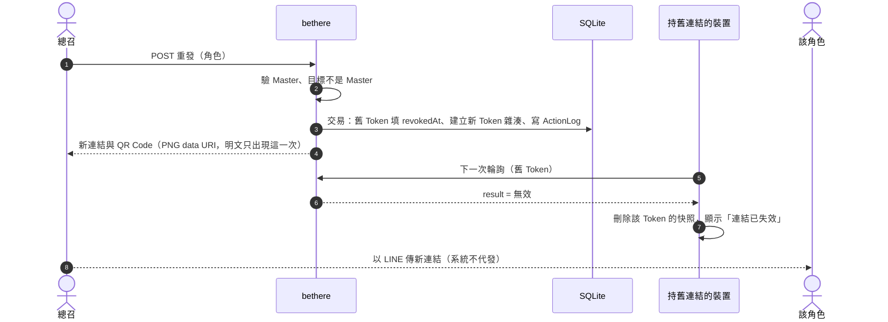
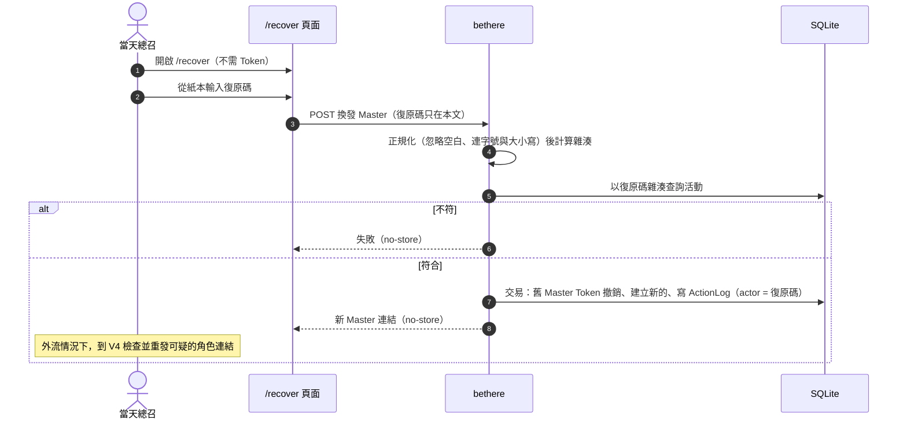
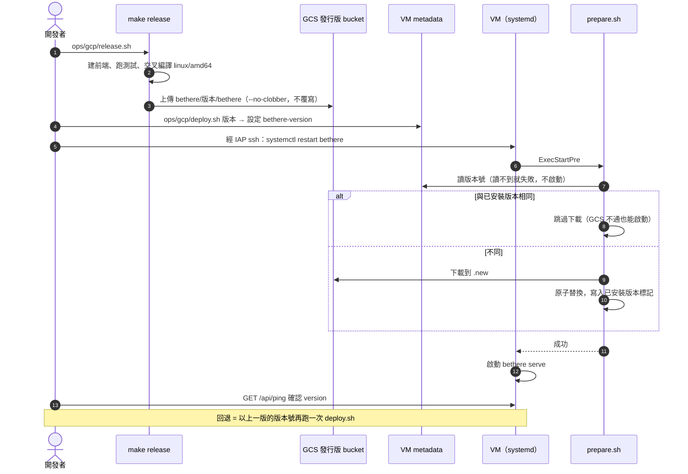
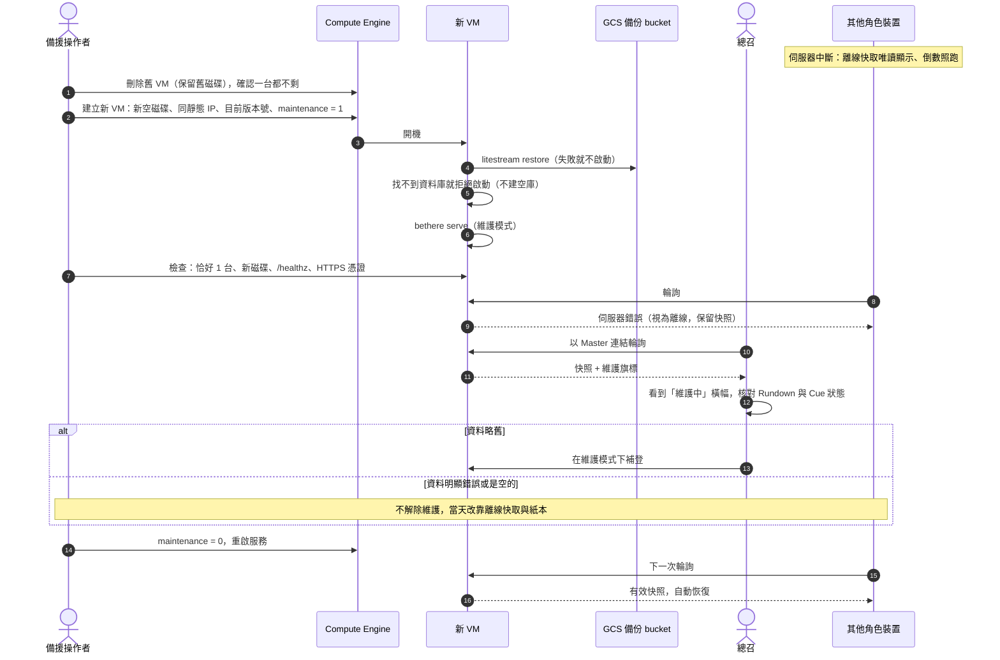

# 執行期視圖 (Runtime Views) — P0 範圍

> 以 UML 循序圖描述關鍵情境。規則細節以 `docs/design/` 為準；元件名稱見 `architecture-overview.md` 第 5 節。
> 圖中「快照」指該角色可見的完整狀態（`sync-and-offline.md` 第 2 節）。

---

## 1. 開啟連結與輪詢

對應：`access-control.md` 3.2、3.3；`sync-and-offline.md` 第 1、5、6 節；ADR-0002、ADR-0004、ADR-0010。

## 2. 總召推進與版本衝突

對應：`sync-and-offline.md` 第 3 節；`data-model.md` 4.1；ADR-0005。

## 3. 時間平移：預覽、套用、各端更新

對應：`data-model.md` 4.2；`screen-design.md` 3.3、4.4；ADR-0006、ADR-0007。

## 4. 撤銷與重發角色連結

對應：`access-control.md` 3.4；`screen-design.md` V4。

## 5. 以復原碼換發 Master 連結

對應：`access-control.md` 第 2 節；ADR-0003。

## 6. 部署與回退

對應：`tech-stack.md` 第 3 節「服務啟動」「部署與回退」；`ops/gcp/`。

## 7. VM 故障重建與維護模式

對應：`tech-stack.md` 3.1 程序 2（要求草案）；ADR-0012、ADR-0013。正式版才有 Litestream 與維護模式，原型尚未實作。

