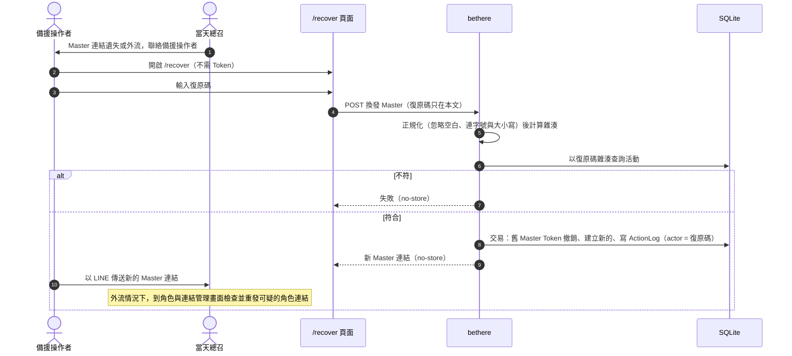
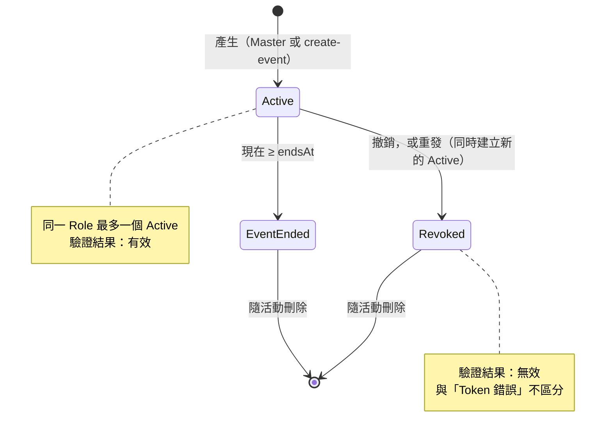
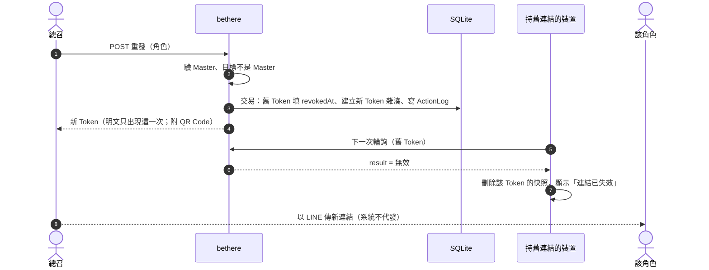

# Token 與權限模型 (Access Control)

> 邏輯設計，不綁定技術棧。涵蓋撤銷、權限範圍、伺服器端過濾、連結發送與活動結束失效；理由見 ADR-0002、ADR-0003、ADR-0007、ADR-0011、ADR-0018。
> 資料實體見 `data-model.md`，快照見 `sync-and-offline.md`。

---

## 1. 威脅模型（刻意保持小）

這是單場、約 10～30 人、免註冊的現場工具。要防的是現實中會發生的事，不是國家級攻擊：

| 威脅 | 現實情境 | 影響 |
| --- | --- | --- |
| 連結外流 | 廠商把連結轉傳到群組、截圖含網址 | 外人看到時程；若是總召連結，還可亂改時程、建立角色給自己，或撤銷全部角色連結造成全場斷線 |
| 越權 | 廠商改網址或打 API，想看別人的 Cue 或做總召的操作 | 資訊外洩、時程被竄改 |
| 猜測連結 | 暴力猜 Token、復原碼或邀請碼 | 128 位元熵下不可行 |
| 復原碼外流 | 紙本遺失或被拍到 | 等同完全接管：可換發 Master、改 Draft 階段的活動日期；只能由開發者以伺服器端指令重設 |
| 邀請碼外流 | 受邀的人把邀請碼轉給別人 | 別人可以建立一場新的活動，碰不到任何現有活動；一碼一場、30 天失效，所以最多多出一場 |
| 維運權限外流 | 備援操作者的 Google 帳號被盜或誤用（`operations/runbook.md` 第 2 節） | 等同完全接管：可改 VM 啟動腳本、登入主機、重設復原碼、讀取資料庫與備份；IAM 權限設到期時間，婚禮後數天自動失效；權限期間留在 VM 上的後門不會跟著失效，所以婚後重建一次 VM（`operations/runbook.md` 第 4 節） |
| 誤操作 | 總召手滑、兩台裝置同時操作 | 時程錯亂（版本號與復原已處理）；匯入取代、刪除 Cue、刪除角色無法復原，所以完整記錄並在活動日當天鎖住匯入取代與刪除角色（ADR-0032） |
| 活動後殘留 | 活動結束後連結仍可看到賓客與流程資料 | 隱私（NFR-5） |

**不在範圍內**：裝置被竊後的深度防護、對抗惡意內部人員（新人自己的親友工作組）。

**接受的風險**：Token 一直留在網址上，截圖、轉傳、瀏覽紀錄同步都可能帶出 Token。對策是事後撤銷重發（3.4），而不是事前遮蔽；換來的是連結在 LINE 內建瀏覽器、Safari、書籤與主畫面之間都能直接開啟（ADR-0002）。

## 2. 身分層級

| 層級 | 誰 | 憑證 | 能做的事 |
| --- | --- | --- | --- |
| **Master（總召）** | 建立活動的人（婚前）與當天擔任總召的人，共用同一個 Master 連結 | Master Token | 編輯 Rundown、推進（活動日當天的第一次推進同時開始活動）、略過、平移、復原、代打卡、產生與重發**非 Master** 的 Token |
| **一般角色** | 新秘、攝影、音控等 | 各自的 Token | 唯讀自己可見的 Cue + 自己的就位打卡 |

**復原碼**：建立活動時由系統隨機產生，128 位元以上，只顯示一次，伺服器只存雜湊。以 Crockford Base32 分組顯示，比對時忽略空白、連字號與大小寫，方便從紙上手打。入口獨立，不需要也不接受 Token；復原碼只放在 POST 本文，回應同樣 `no-store`。只用於以下三件事：
1. 換發 Master 連結：舊的 Master Token 同時失效；復原碼不變，懷疑外流時由開發者重設。
2. 修改活動日期（`eventDate`）：只限 Draft 階段，且原本與修改後的結束時間都必須晚於現在（已過期的活動不能改日期復活）；所有 Cue 的表定時間一併平移相同天數。`timezone` 在建立活動時決定，之後不能改。活動日期決定活動何時結束，所以 Master Token 不能改。
3. 活動結束後、資料刪除前，唯讀匯出事後紀錄（P1，`requirements/scope.md`）。

復原碼由**備援操作者**保管，不交給總召（ADR-0018；以邀請碼建立的活動由建立者交給總召以外的人），並且與 Master 連結**分開保存**，不能只有新人本人知道。總召遺失 Master 連結時聯絡備援操作者，由備援操作者在 `/recover` 換發後以 LINE 傳給總召。建立活動的指令與 `/new` 只把兩者顯示一次，不寫入任何日誌或儲存。復原碼單獨外流就等同完全接管（見第 1 節），只能由開發者以伺服器端指令重設。

以復原碼換發 Master 連結的流程：

> Master 角色唯一且不能新增、刪除，也不能改類型或畫面（只能改名；見 `data-model.md` Role），加上 Master 連結不能重發 Master、不能改活動日期、只能在活動當天開始活動，拿到外流 Master 連結的人無法把總召鎖在外面，也無法讓活動提前開始或結束。

**建立活動**（ADR-0036）：開發者以伺服器端指令建立，或由拿到**邀請碼**的人在 `/new` 建立。邀請碼由開發者以 `bethere create-invite` 產生，格式、比對與雜湊規則與復原碼相同，只顯示一次，伺服器只存雜湊與到期時間（30 天）；只放在 POST 本文，不需要也不接受 Token。建立時先以唯讀查詢比對（猜錯不佔用寫入），符合時在單一交易內刪除邀請碼並建立活動，所以一碼只能建立一場。邀請碼不正確、已用、已過期都回同一個錯誤。建立者在同一個回應拿到 Master 連結與復原碼，復原碼由他交給總召以外的人保管。維護模式下一律拒絕，帶著任何 Master 連結也一樣。

## 3. Token 設計

### 3.1 格式與儲存
- 隨機產生，至少 128 位元熵（以 URL-safe 字元編碼，約 22 字元以上）。
- 伺服器只存**雜湊**，明文只在產生當下顯示（資料模型 `AccessToken.tokenHash`）。
- 單一 Role 同一時間最多一個有效 Token；重發 = 撤銷舊的、建立新的。
- Token 沒有自己的到期時間，一律跟著所屬活動的結束時間（`Event.endsAt`，見 `data-model.md`）。

### 3.2 連結形式
連結形如 `https://<host>/#t=<token>`，Token 放在 **URL 片段（`#` 之後）**，而且**一直留在網址上，不清除**：

- 片段**不會被送到伺服器**，也不會出現在 Referer 與伺服器存取紀錄裡；LINE 等通訊軟體產生連結預覽時，爬蟲也拿不到 Token。
- 頁面**一律以網址中的 Token 為準**，每次開啟都從網址讀取，不依賴本機儲存。目標是從 LINE 內建瀏覽器改用 Safari 開、加入書籤、加到主畫面時都帶著 Token；這依賴瀏覽器保留片段，**須實機驗證**（iOS 已驗證，見 `tech-stack.md` 5.1；Android 見 `docs/README.md` 的 RISK-1）。
- 前端以一般 HTTP 請求呼叫 API（同步方式為輪詢，見 `sync-and-offline.md` 第 1 節），Token 放在請求標頭，不放查詢字串。
- 因為網址含 Token：不載入任何第三方腳本，並設定嚴格的內容安全政策（CSP）。

### 3.3 驗證結果與附加保護
- 所有頁面回應 `Referrer-Policy: no-referrer`、`X-Robots-Tag: noindex`；API 回應一律 `Cache-Control: no-store`。
- **每個請求都先驗證 Token**，結果只有三種，依序判斷，並以應用層的結構化回應表示（例如 JSON 的 `result` 欄位）：

  | 結果 | 條件 | 客戶端行為 |
  | --- | --- | --- |
  | 無效 | Token 錯誤或已撤銷（不區分兩者） | 顯示「連結已失效，請向總召索取新連結」，停止輪詢並清除該 Token 的本機資料 |
  | 已結束 | Token 正確且未撤銷，但已過 `Event.endsAt` | 顯示「活動已結束，感謝你的協助」，清除該 Token 的本機資料；回應不附帶任何活動資料 |
  | 有效 | 其餘 | 正常回傳快照；活動尚未開始（`eventStatus = Draft`）時，非 Master 角色顯示「活動尚未開始」 |

- **只有可解析、且 `result` 明確為「無效」或「已結束」的回應會清除本機資料**。其他情況一律視為離線，保留快照繼續唯讀顯示，包括：只看 HTTP 狀態碼的錯誤（401、403、5xx）、會場 Wi-Fi 的登入頁、無法解析的內容、逾時、網路失敗。
- 伺服器只有在儲存層查詢成功、且確實查無有效 Token 時才回「無效」；資料庫或時間計算出錯時一律回伺服器錯誤，客戶端視為離線。
- 不對 Token、復原碼與邀請碼做頻率限制：三者都是 128 位元以上，無法暴力猜測；而會場 Wi-Fi 或熱點常共用同一個對外 IP，依 IP 限頻反而可能擋到全場。
- 每個 Token 記錄 `lastSeenAt`（只存在伺服器記憶體、驗證成功後才更新，見 `tech-stack.md` 2.1「lastSeenAt」），總召可看到「誰的連結最近有人在用」。
- 連結一產生就能使用，不設生效時間；活動到 `Event.endsAt`（活動日隔天 04:00）自動結束。

### 3.4 撤銷
- 撤銷後，伺服器對該 Token 的請求立即回應「無效」；對方裝置在下一次輪詢（約 2 秒內）就會收到，並依 3.3 處理。
- 重發新連結時，舊連結同時失效；總召介面顯示新的連結與「複製」按鈕，並附 QR Code（`requirements/stories.md` US-M-13）。
- Master 連結外流或遺失時，以復原碼換發（見第 2 節）；其他仍使用舊 Master 連結的裝置需要改用新連結。外流情況下，換發後應在角色與連結管理畫面檢查角色清單（ActionLog 記有舊連結建立或重發過的角色），撤銷或重發可疑的連結。

連結的狀態：

撤銷與重發的流程：

## 4. 授權：動作權限表

權限以**動作（capability）** 為單位，由 Token 所屬 Role 的 `type` 決定。伺服器對每個請求先驗 Token，再依 capability 判斷，**不信任客戶端傳來的角色資訊**。

| Capability | Master | Stylist / Media / StageAV | Host |
| --- | --- | --- | --- |
| 讀取全部 Cue 與各角色狀態 | ✔ | ✘ | ✘ |
| 讀取自己 `CueRole` 內的 Cue | — | ✔ | ✘ |
| 讀取彙總指標（延誤、目前環節） | ✔ | ✘ | ✔ |
| 推進 / 略過 Cue（活動日當天的第一次推進同時開始活動，ADR-0020） | ✔ | ✘ | ✘ |
| 時間平移、復原 | ✔ | ✘ | ✘ |
| 自己的就位打卡 / 取消 | ✘ | ✔ | ✘ |
| 代他人就位打卡 | ✔ | ✘ | ✘ |
| 編輯 Rundown（Draft 階段，不含活動日期與時區） | ✔ | ✘ | ✘ |
| 編輯 Rundown（Live 階段） | ✔（有限，見下） | ✘ | ✘ |
| 產生 / 撤銷 / 重發 Token | ✔（非 Master） | ✘ | ✘ |
| 匯出備援 Rundown | ✔（全部） | ✔（僅自己的） | ✘ |

四種工作（VenueLead、Runner、Reception、Cashier）與 Stylist、Media、StageAV 同欄，另各多一項（`api.md` 9.3～9.6）：

| Capability | Master | VenueLead | Runner | Reception | Cashier | 其他 |
| --- | --- | --- | --- | --- | --- | --- |
| 對自己的 Cue 回覆收到 | ✘ | ✔ | ✘ | ✘ | ✘ | ✘ |
| 新增任務 | ✔ | ✘ | ✘ | ✔（呼叫機動組） | ✘ | ✘ |
| 認領、放回、完成任務 | ✔（任何任務，不替人認領） | ✘ | ✔（只限自己認領的） | ✘ | ✘ | ✘ |
| 刪除任務、匯入賓客名單、設定檢核表 | ✔ | ✘ | ✘ | ✘ | ✘ | ✘ |
| 讀取賓客名單、替賓客報到 | ✔ | ✘ | ✘ | ✔ | ✘ | ✘ |
| 讀取與勾選檢核表 | ✔ | ✘ | ✘ | ✘ | ✔ | ✘ |

說明：
- **活動不需手動結束**：到 `Event.endsAt` 自動結束（見 3.3），不會因為忘了按而讓連結一直有效。
- **復原碼的三項用途**（第 2 節）不在表內，它們不經過 Token。
- **Live 階段的有限編輯**：只允許改標題、備註、新增 Cue、略過，以及替 `Pending` 的 Cue 新增或移除角色指派（`data-model.md` 4.6，ADR-0021）；不允許改既有 Cue 的 `scheduledStart` 等結構性欄位（避免與平移衝突），已開始、已完成、已略過的 Cue 不能改指派。刪除 Cue 改為略過，以保留紀錄。
- **Host 的視圖**只回傳彙總資訊（延誤、目前環節的標題），伺服器根本不產生 Cue 清單與求助訊息（ADR-0007）。
- **賓客名單**只有 Master 與 Reception 的快照帶，其他角色與 Host 的快照沒有任何賓客資料（`api.md` 9.5）。

## 5. 伺服器端強制規則

1. **每個請求都驗證**：Token 有效（未撤銷、活動未結束）→ 取得 Role → 檢查 capability → 才執行。
2. **資料過濾在查詢層**：快照由伺服器依 Role 組裝，Cue 清單只含該角色的 `CueRole`。不是回完整資料再由前端隱藏。
3. **寫入檢查歸屬**：就位打卡只能針對「自己的 `roleId`」；代打卡必須是 Master 且寫入 `byRoleId`。
4. **Token 與 Event 綁定**：Token 只能存取所屬 Event，無法跨活動。
5. **所有改變狀態的操作寫入 ActionLog**，含 Token 重發與撤銷、以復原碼進行的操作與唯讀匯出（誰、何時、對哪個 Role）。
6. **操作者綁定憑證**：store 的每個寫入都帶操作者，只能從驗證過的 Token 或復原碼取得，並帶著該憑證的雜湊；每次寫入都重新確認憑證仍有效、屬於該活動，所以撤銷的連結、重設的復原碼、刪除後重新配發的 id 都無法再寫入。復原碼只能做第 2 節的三件事（換發 Master 連結、Draft 階段改日期並一併平移所有 Cue、結束後唯讀匯出並寫入稽核）；其他寫入只接受角色。`events`、`roles`、`access_tokens`、`cues` 的 id 刪除後不再配發；`check_ins`、`action_logs` 的 id 只在內部使用。每種角色能做什麼（第 4 節）由呼叫端檢查。

## 6. 連結發送流程

1. 開發者以指令、或受邀的人以邀請碼在 `/new` 建立活動（第 2 節），系統產生 Master 角色、Master 連結與復原碼。
2. 在主控台建立 Role，系統為每個 Role 產生連結與 QR Code。
3. 自行以 LINE 等管道傳給各人，**系統不代發**。連結一收到就能開啟，活動開始前顯示「活動尚未開始」。
4. 接收者之後可直接點原本的 LINE 訊息、書籤或主畫面圖示開啟，網址都帶著 Token。
5. 活動前把 Master 連結交給當天的總召；復原碼交給備援操作者，以邀請碼建立的活動則交給總召以外的人（見第 2 節）。
6. 換手機或清除資料：重新點開原本的 LINE 訊息即可，不需要重發。連結被撤銷時，才向總召索取新連結。
