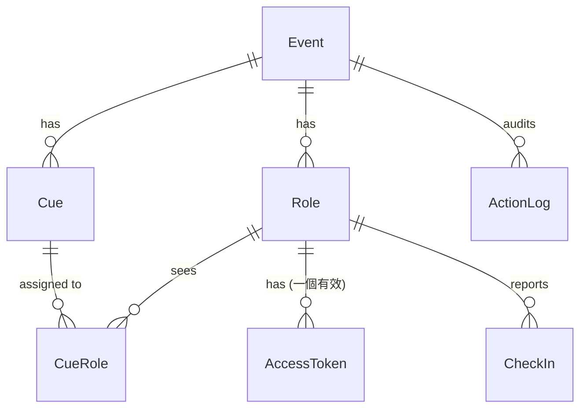
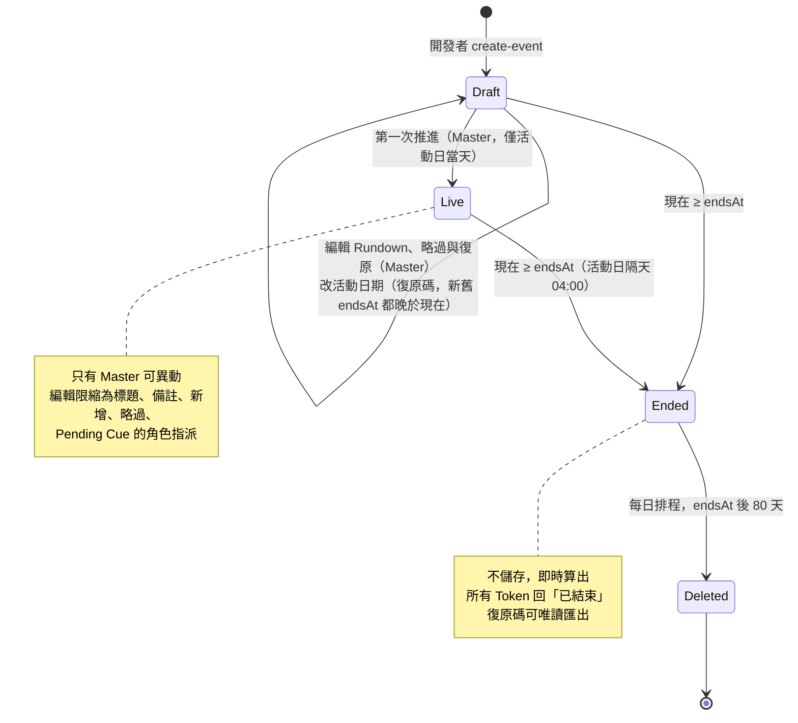
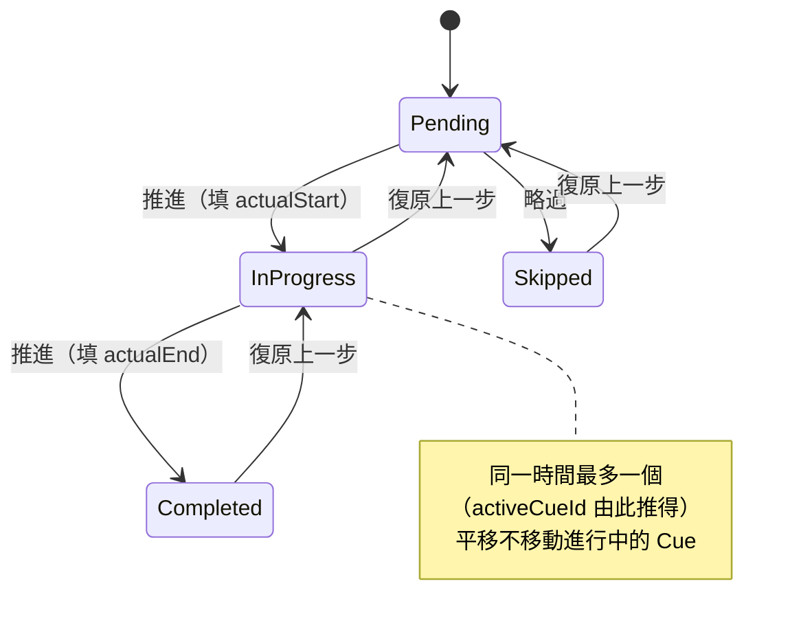
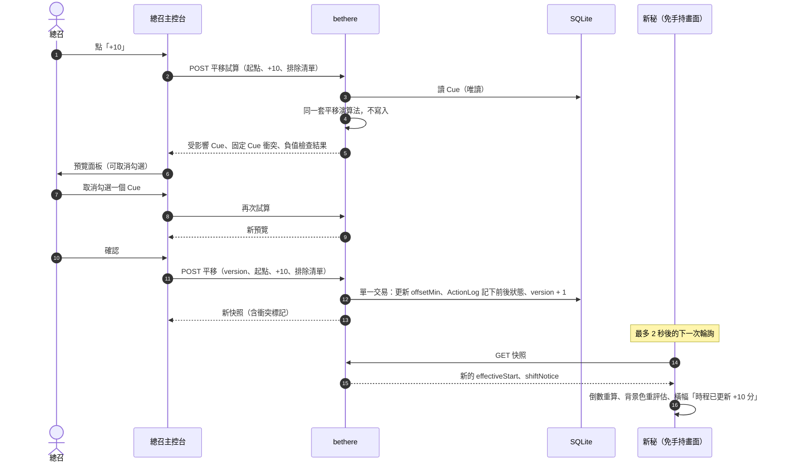
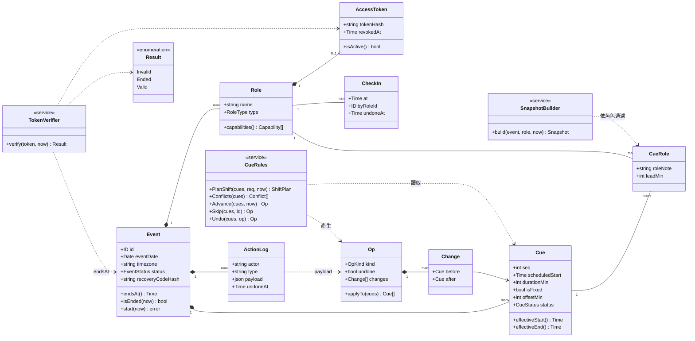

# 資料模型 (Data Model) — P0 範圍

> 邏輯模型，不綁定資料庫或技術棧。範圍：P0（Rundown、推進 Cue、時間平移、Token 角色視圖、新秘倒數、就位打卡）。
> P1 實體只預留位置，列在最後。

---

## 1. 設計原則

1. **有效時間 = 表定時間 + 該 Cue 的累計偏移**，由伺服器計算後下發，客戶端不自行推算平移。
2. **時間平移是一次「有紀錄的操作」**，記錄影響到哪些 Cue，所以可以精確復原（ADR-0006、ADR-0015）。
3. **伺服器時間為準**（`sync-and-offline.md` 第 4 節），所有時間戳記以 UTC 儲存，顯示時轉為活動時區。
4. **權限跟著 Token 走**，Token 與 Role 分開存放，才能單獨撤銷與重發（`access-control.md` 3.4）。
5. **過濾在伺服器端**（ADR-0007）：每個角色視圖只回傳該角色可見的欄位與 Cue。

## 2. 實體關係

## 3. 實體定義

### Event（活動）
| 欄位 | 型別 | 說明 |
| --- | --- | --- |
| id | ID | |
| name | text | 例：「2027/06/06 婚宴」 |
| eventDate | date | 年份限 2000～2199，Cue 時間同樣限在這個範圍，確保以奈秒儲存與日期運算不會溢位 |
| timezone | text | 預設 `Asia/Taipei`；只接受程式內的時區清單（目前只有 `Asia/Taipei`），確保在任何主機都讀得回來 |
| status | enum | 儲存 `Draft` / `Live`（Live 後只有總召可異動）；`Ended` 不儲存，見下方衍生值 |
| liveStartedAt | timestamp? | 活動開始（活動日當天第一次推進）的時間 |
| activeCueId | ID? | 目前進行中的 Cue。**不儲存**，由狀態為 `InProgress` 的 Cue 推得，避免兩份真相 |
| recoveryCodeHash | text | 復原碼的雜湊（見 `access-control.md` 第 2 節） |

`timezone` 建立後不可修改；`eventDate` 只能以復原碼、在 Draft 階段修改（見 `access-control.md` 第 2 節）。活動只能在 `eventDate` 當天（依 `timezone`）開始：Draft 狀態下的第一次推進在同一筆交易內把活動改為 Live 並開始第一個 Cue；復原這次推進時活動仍維持 Live（ADR-0020）。

**衍生值（不存）**
- `endsAt` = `eventDate` 隔天 04:00（依 `timezone` 換算為 UTC）。
- 現在 ≥ `endsAt` 時，活動視為 `Ended`：所有 Token 回應「已結束」，資料於 `endsAt` 後 80 天刪除，伺服器端所有副本 90 天內消失（ADR-0011）。結束判斷不需要排程器；刪除由伺服器內的每日排程執行（`tech-stack.md` 2.1「資料刪除」）。Live 之後日期不能再改，所以結束與刪除時間在活動開始後就固定。

### Cue（流程節點）
| 欄位 | 型別 | 說明 |
| --- | --- | --- |
| id | ID | |
| eventId | ID | |
| seq | int | 順序，唯一、連續 |
| title | text | 例：「一進預備」 |
| scheduledStart | timestamp | 表定開始時間，**建立後只有編輯 Rundown 才會改，平移不動它** |
| durationMin | int | 預計長度，用來偵測 Fixed 衝突 |
| isFixed | bool | 平移時跳過（4.2） |
| offsetMin | int | 累計偏移（可為負），預設 0 |
| status | enum | `Pending` / `InProgress` / `Completed` / `Skipped` |
| actualStart | timestamp? | 實際開始，供事後檢討 |
| actualEnd | timestamp? | 實際結束 |
| notePublic | text? | 所有被指派角色都可見的說明 |

**衍生值（不存）**
- `effectiveStart = scheduledStart + offsetMin`
- `effectiveEnd = effectiveStart + durationMin`

### Role（角色）
| 欄位 | 型別 | 說明 |
| --- | --- | --- |
| id | ID | |
| eventId | ID | |
| name | text | 例：「新秘」、「婚攝 A」 |
| type | enum | `Master` / `Stylist` / `Media` / `StageAV` / `VenueLead` / `Reception` / `Cashier` / `Runner` / `Host` |
| displayOrder | int | |
| view | enum? | 使用哪種畫面：`HandsFree`（免手持）／`Glance`（快速瞄）／`Dashboard`（平安儀表板）／`Console`（主控台）。未設定時依類型預設：Master → Console、Host → Dashboard、Stylist → HandsFree、其他 → Glance。必須與類型相容：Master 只能 Console、Host 只能 Dashboard，其他類型只能 HandsFree 或 Glance。在建立角色時設定（ADR-0025） |
| checksIn | bool? | 是否需要就位打卡（ADR-0031）。未設定時依類型：Stylist、Media、StageAV 打卡，其他不打卡；只能設為「不打卡」，不能讓 Host 或 Master 打卡。總召在畫面上新增角色時設定，之後不可修改 |

`type` 決定可做的動作與快照內容，建立後不可修改。每個活動只有一個 `Master` 角色，在建立活動時產生，不能新增、刪除。一般角色只能在 Draft 階段刪除，刪除時在同一交易內撤銷其 Token 並移除 CueRole。**一個 Role 是一個「位子」**，同一位子可被多支手機同時使用；兩位攝影師就建兩個 Role。

### AccessToken（存取憑證）
| 欄位 | 型別 | 說明 |
| --- | --- | --- |
| id | ID | |
| roleId | ID | |
| tokenHash | text | 只存雜湊，明文僅在產生時顯示一次 |
| createdAt | timestamp | |
| revokedAt | timestamp? | 撤銷時間（`access-control.md` 3.4） |
| lastSeenAt | timestamp? | 最近一次使用，供總召查看連結是否在使用。**不存資料庫**，只存在伺服器記憶體，重啟後歸零（`tech-stack.md` 2.1「lastSeenAt」） |

規則：每個 Role 同一時間最多一個有效 Token；重發 = 撤銷舊的並建立新的。Token 沒有自己的到期時間，跟著 `Event.endsAt`。

### CueRole（角色與 Cue 的關聯）
| 欄位 | 型別 | 說明 |
| --- | --- | --- |
| cueId, roleId | ID | 複合唯一 |
| roleNote | text? | 該角色專屬的任務備註 |
| leadMin | int? | 預警分鐘數（P1 推播用，P0 先預留） |

**可見性規則**：角色只看得到有 CueRole 的 Cue。`Master` 與 `Host` 為例外（Master 全看；Host 只看儀表板彙總，不看 Cue 細節）。

### CheckIn（就位打卡）
| 欄位 | 型別 | 說明 |
| --- | --- | --- |
| id | ID | |
| roleId | ID | |
| at | timestamp | |
| byRoleId | ID | 本人打卡 = roleId；總召代打 = Master 的 roleId |
| undoneAt | timestamp? | 誤按可取消 |

一個 Role 目前是否就位 = 存在未取消的 CheckIn。

### 平移紀錄
不另建表。平移與推進、略過一樣是「Cue 操作」，寫入 ActionLog（`type` 為 `cue.advance`、`cue.skip`、`cue.shift`），`payload` 只記下每個**實際被改到**的 Cue 在操作前後的狀態（`status`、`offsetMin`、`actualStart`、`actualEnd`），不含標題等可編輯文字；平移另記總召的要求（起點、平移量、取消勾選的 Cue），供事後檢討。復原就是把這些 Cue 還原成操作前的狀態；某次平移的量等於前後 `offsetMin` 之差。理由見 `decisions.md`。

### ActionLog（操作紀錄）
`id, eventId, actor, at, type, payload, undoneAt`。Cue 操作（`cue.*`）的 `payload` 含前後狀態，`undoneAt` 在被復原時填入；「復原上一步」找最近一筆 Cue 操作，已復原過就不能再復原（4.1）。`actor` 為 Role，或「復原碼」。涵蓋推進、略過、平移、復原、代打卡、Token 重發與撤銷、以復原碼進行的操作。事後檢討與除錯用；活動結束後可憑復原碼唯讀匯出（P1，`requirements/scope.md`）。

## 4. 核心行為規則

### 4.1 狀態轉換

活動的生命週期：

Cue 的狀態：

- 同一時間只有一個 `InProgress` 的 Cue（`Event.activeCueId`）。若現場要重疊進行，列為後續需求。
- 推進為 InProgress 時填 `actualStart`；Completed 時填 `actualEnd`。
- 主控台的「推進」在同一筆交易內把目前 Cue 改為 Completed、下一個 Pending 改為 InProgress；復原時兩者一起回退（US-M-3.2、US-M-4.1）。
- 「復原上一步」只能回退最近一次操作，並寫入 ActionLog。略過也可以復原，Cue 回到 `Pending`。

### 4.2 時間平移演算法
輸入：`fromCueId`、`deltaMin`、`excludedCueIds`（總召取消勾選的）。

1. 取得 `seq >= from.seq` 的 Cue。
2. 只保留：`status = Pending`、`isFixed = false`、不在 `excludedCueIds`；`deltaMin < 0` 時，另外排除平移前 `effectiveStart` 就已早於「現在」的 Cue（已逾時）。
3. **負值檢查**（只在 `deltaMin < 0` 時進行）：若任一保留的 Cue 平移後的 `effectiveStart` 早於「現在」，整次操作拒絕並說明是哪個 Cue。正值平移不做這項檢查，因為延誤時平移後仍早於現在是正常情況。
4. 對每個保留的 Cue：`offsetMin += deltaMin`，並在 ActionLog 記下該 Cue 平移前後的狀態。
5. **Fixed 衝突檢查**：平移後，若某 Cue 的 `effectiveEnd` 晚於其後最近一個 Fixed Cue 的 `scheduledStart`，**不阻擋**，但標記衝突並在主控台顯示。
   **時間倒序檢查**：任一 Pending Cue 的 `effectiveStart` 早於 `seq` 在它前面最近一個未略過 Cue 的 `effectiveStart` 時，同樣不阻擋、只標記（取消勾選平移或活動中新增 Cue 都可能造成，ADR-0021）。
6. 整個過程是單一交易，完成後 `eventVersion + 1`，各端在下一次輪詢取得新狀態。

`InProgress` 的 Cue 不被平移（它已經開始了）；若總召想延長目前環節，用平移其下一個 Cue 起算。

從預覽到各端更新的流程（預覽與套用用同一套演算法，ADR-0007）：

### 4.3 「全域偏移」、超時與延誤的顯示值
- 各畫面顯示的「+N 分」= **目前 InProgress（或下一個 Pending）Cue 的 `offsetMin`**。
- **超時分鐘** = `max(0, 現在 − 下一個 Pending Cue 的 effectiveStart)`，向下取整。以下一個待辦 Cue 為準，因為進行中的 Cue 不被平移（4.2）；總召平移後續後超時即歸零。超時達 5 分鐘時，主控台提示平移，預填量為超時分鐘以 5 為單位無條件進位（ADR-0022）。
- 新人儀表板的**延誤** = 下一個 Pending Cue 的 `offsetMin` + 超時分鐘，也就是下一個環節比原表晚多少；沒有待辦 Cue 時用上述「+N 分」的值。未滿 5 分鐘顯示「一切順利」（ADR-0026）。
- 超時與延誤由伺服器在快照中算好（ADR-0007）。

### 4.4 角色視圖的資料範圍
| 角色 | 可讀 | 可寫（動作） |
| --- | --- | --- |
| Master | 全部 | 推進、略過、平移、復原、代打卡、重發非 Master 的 Token、編輯 Rundown（Live 時限縮，見 `access-control.md` 第 4 節） |
| Stylist / Media / StageAV | 自己有 CueRole 的 Cue + 該 Cue 的 `roleNote` | 自己的就位打卡 |
| 其餘角色（暫停，ADR-0033） | 同上 | 各自動作（恢復時再定義） |

### 4.5 領域服務

Cue 操作的實作在 `internal/domain`。只列與行為有關的欄位與操作。

| 服務 | 規則 | 測試重點 |
| --- | --- | --- |
| CueRules（`internal/domain`） | `PlanShift` 同時供預覽與正式寫入；Op 由 `internal/store` 在單一交易內寫入並使 `eventVersion + 1` | 固定 Cue、排除勾選、進行中不動、負值時排除已逾時並拒絕早於現在、Fixed 衝突只警告、復原精確 |
| SnapshotBuilder | 只含該角色可見的 Cue 與欄位；Master 帶完整 CueRole 與維護旗標 | 每種角色的鍵集合；Host 不含 Cue |
| TokenVerifier | 依序判斷無效 → 已結束 → 有效；儲存層錯誤回錯誤而非「無效」 | 撤銷、過期、時區邊界、資料庫錯誤 |

### 4.6 活動中新增 Cue 與改派角色

Live 階段的規則（ADR-0021）：

- **新增 Cue**：輸入實際要開始的時間、`durationMin`、標題與插入位置（插在哪個 Cue 之後）。輸入的時間存成 `scheduledStart`，`offsetMin = 0`，狀態為 `Pending`；插入位置之後的 Cue `seq` 依序加一，維持唯一、連續。
- **改派角色**：只能對 `Pending` 的 Cue 新增或移除 CueRole（含 `roleNote`）。
- 以上都寫入 ActionLog，`type` 不以 `cue.` 開頭（例如 `rundown.insert`、`rundown.assign`），不算「復原上一步」的步驟（ADR-0015）。
- 新指派的角色在下一次快照收到變更提示（`sync-and-offline.md` 第 2 節）。

## 5. P1 預留（P0 不實作）

| 實體 | 用途 | 備註 |
| --- | --- | --- |
| Ack | 領班「已收到」雙向確認 | `cueId, roleId, ackedAt` |
| Task | 機動組任務池與認領 | `title, status, claimedByRoleId` |
| AssetRef | 音控檔名對照 | 可先放在 `CueRole.roleNote`，需要時再拆 |
| SupportRequest | 求助訊息（只路由給 Master 與 Runner） | 伺服器端過濾的對象（ADR-0007） |
