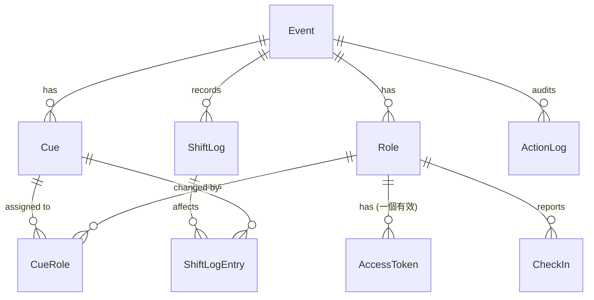

# 資料模型 (Data Model) — P0 範圍

> 邏輯模型，不綁定資料庫或技術棧。範圍：P0（Rundown、推進 Cue、時間平移、Token 角色視圖、新秘倒數、就位打卡）。
> P1 實體只預留位置，列在最後。

---

## 1. 設計原則

1. **有效時間 = 表定時間 + 該 Cue 的累計偏移**，由伺服器計算後下發，客戶端不自行推算平移。
2. **時間平移是一次「有紀錄的操作」**，記錄影響到哪些 Cue，所以可以精確復原（A7）。
3. **伺服器時間為準**（E7），所有時間戳記以 UTC 儲存，顯示時轉為活動時區。
4. **權限跟著 Token 走**，Token 與 Role 分開存放，才能單獨撤銷與重發（F1）。
5. **過濾在伺服器端**（F3）：每個角色視圖只回傳該角色可見的欄位與 Cue。

## 2. 實體關係



## 3. 實體定義

### Event（活動）
| 欄位 | 型別 | 說明 |
| --- | --- | --- |
| id | ID | |
| name | text | 例：「2027/06/06 婚宴」 |
| eventDate | date | |
| timezone | text | 預設 `Asia/Taipei` |
| status | enum | `Draft` / `Live` / `Ended`（B6：Live 後只有總召可異動） |
| liveStartedAt | timestamp? | 按「開始活動」的時間 |
| endedAt | timestamp? | Ended 後 Token 失效，90 天後刪除資料（C5） |
| activeCueId | ID? | 目前進行中的 Cue |

> README 的 `GlobalOffsetMinutes` **不再存為欄位**，改為由 Cue 偏移推導（見 4.2），避免兩份真相。

### Cue（流程節點）
| 欄位 | 型別 | 說明 |
| --- | --- | --- |
| id | ID | |
| eventId | ID | |
| seq | int | 順序，唯一、連續 |
| title | text | 例：「一進預備」 |
| scheduledStart | timestamp | 表定開始時間，**建立後只有編輯 Rundown 才會改，平移不動它** |
| durationMin | int | 預計長度，用來偵測 Fixed 衝突 |
| isFixed | bool | A2：平移時跳過 |
| offsetMin | int | 累計偏移（可為負），預設 0 |
| status | enum | `Pending` / `InProgress` / `Completed` / `Skipped` |
| actualStart | timestamp? | 實際開始（C3） |
| actualEnd | timestamp? | 實際結束 |
| notePublic | text? | 所有被指派角色都可見的說明 |

**衍生值（不存）**
- `effectiveStart = scheduledStart + offsetMin`
- `effectiveEnd = effectiveStart + durationMin`

### Owner（擁有者）
Event 的管理者，**不是 Role**，沒有 Token，用管理密碼登入（見 `access-control.md` P1）。
| 欄位 | 說明 |
| --- | --- |
| eventId | 所屬活動 |
| passwordHash | 管理密碼的雜湊 |

### Role（角色）
| 欄位 | 型別 | 說明 |
| --- | --- | --- |
| id | ID | |
| eventId | ID | |
| name | text | 例：「新秘」、「婚攝 A」 |
| type | enum | `Master` / `Stylist` / `Media` / `StageAV` / `VenueLead` / `Reception` / `Cashier` / `Runner` / `Host` |
| displayOrder | int | |

`type` 決定使用哪種視圖與可做的動作。**一個 Role 是一個「位子」**，同一位子可被多支手機同時使用；兩位攝影師就建兩個 Role。

### AccessToken（存取憑證）
| 欄位 | 型別 | 說明 |
| --- | --- | --- |
| id | ID | |
| roleId | ID | |
| tokenHash | text | 只存雜湊，明文僅在產生時顯示一次 |
| createdAt | timestamp | |
| notBefore | timestamp | 生效時間，預設為活動前一天 |
| expiresAt | timestamp | 預設為活動結束後 |
| revokedAt | timestamp? | F1：撤銷 |
| lastSeenAt | timestamp? | 最近一次使用，供總召查看連結是否在使用 |

規則：每個 Role 同一時間最多一個有效 Token；重發 = 撤銷舊的並建立新的。

### CueRole（角色與 Cue 的關聯，即 README 的 RoleCueMapping）
| 欄位 | 型別 | 說明 |
| --- | --- | --- |
| cueId, roleId | ID | 複合唯一 |
| roleNote | text? | 該角色專屬的任務備註 |
| leadMin | int? | 預警分鐘數（P1 推播用，P0 先預留） |

**可見性規則**：角色只看得到有 CueRole 的 Cue。`Master` 與 `Host` 為例外（Master 全看；Host 只看儀表板彙總，不看 Cue 細節）。

### CheckIn（就位打卡，A4）
| 欄位 | 型別 | 說明 |
| --- | --- | --- |
| id | ID | |
| roleId | ID | |
| at | timestamp | |
| byRoleId | ID | 本人打卡 = roleId；總召代打 = Master 的 roleId |
| undoneAt | timestamp? | 誤按可取消 |

一個 Role 目前是否就位 = 存在未取消的 CheckIn。

### ShiftLog / ShiftLogEntry（時間平移紀錄）
**ShiftLog**
| 欄位 | 說明 |
| --- | --- |
| id, eventId | |
| deltaMin | 平移量（可為負，A3） |
| fromCueId | 起點 Cue（含） |
| createdAt, byRoleId | |
| undoneAt | 復原時填入 |

**ShiftLogEntry**：`shiftLogId`, `cueId`, `appliedDeltaMin`。
只記錄**實際被改到**的 Cue，這樣復原只要把 `appliedDeltaMin` 反向扣回。

### ActionLog（操作紀錄，C3）
`id, eventId, actor, at, type, payload`。`actor` 為 Role 或 Owner。涵蓋推進、略過、平移、復原、代打卡、Token 重發與撤銷。事後檢討與除錯用。

## 4. 核心行為規則

### 4.1 狀態轉換
```
Pending ──► InProgress ──► Completed
   │             │              │
   └──► Skipped  └─(復原)─► Pending / InProgress ◄─(復原)
```
- 同一時間只有一個 `InProgress` 的 Cue（`Event.activeCueId`）。若現場要重疊進行，列為後續需求。
- 推進為 InProgress 時填 `actualStart`；Completed 時填 `actualEnd`。
- 「復原上一步」只能回退最近一次操作，並寫入 ActionLog。

### 4.2 時間平移演算法（A1～A3）
輸入：`fromCueId`、`deltaMin`、`excludedCueIds`（總召取消勾選的）。

1. 取得 `seq >= from.seq` 的 Cue。
2. 只保留：`status = Pending`、`isFixed = false`、不在 `excludedCueIds`。
3. 對每個保留的 Cue：`offsetMin += deltaMin`，並寫入 `ShiftLogEntry`。
4. **負值檢查**（A3）：若任一 Cue 的新 `effectiveStart` 早於「現在」，整次操作拒絕並說明是哪個 Cue。
5. **Fixed 衝突檢查**：平移後，若某 Cue 的 `effectiveEnd` 晚於其後最近一個 Fixed Cue 的 `scheduledStart`，**不阻擋**，但標記衝突並在主控台顯示（A2）。
6. 整個過程是單一交易，完成後一次廣播新狀態。

`InProgress` 的 Cue 不被平移（它已經開始了）；若總召想延長目前環節，用平移其下一個 Cue 起算。

### 4.3 「全域偏移」的顯示值
各畫面顯示的「+N 分」= **目前 InProgress（或下一個 Pending）Cue 的 `offsetMin`**。新人儀表板（P1）的「時程偏移狀態」也用這個值。

### 4.4 角色視圖的資料範圍
| 角色 | 可讀 | 可寫（動作） |
| --- | --- | --- |
| Master | 全部 | 推進、略過、平移、復原、代打卡、重發 Token、編輯 Rundown |
| Stylist / Media / StageAV | 自己有 CueRole 的 Cue + 該 Cue 的 `roleNote` | 自己的就位打卡 |
| 其餘 P1 角色 | 同上 | 各自動作（P1 再定義） |

## 5. P1 預留（P0 不實作）

| 實體 | 用途 | 備註 |
| --- | --- | --- |
| Ack | 領班「已收到」雙向確認 | `cueId, roleId, ackedAt` |
| Task | 機動組任務池與認領 | `title, status, claimedByRoleId` |
| AssetRef | 音控檔名對照 | 可先放在 `CueRole.roleNote`，需要時再拆 |
| SupportRequest | 求助訊息（只路由給 Master 與 Runner） | F3 的過濾對象 |

## 6. 待你確認的設計決定

| # | 決定 | 預設（已確認 ☑） |
| --- | --- | --- |
| M1 | 偏移存在**每個 Cue 上**（`offsetMin`），而不是只存一個全域值 | 是，原因：有 Fixed Cue、排除勾選、略過時，全域值無法表達 ☑ |
| M2 | Cue 有 `durationMin`，用來偵測 Fixed 衝突 | 是 ☑ |
| M3 | 同一時間只有一個 InProgress Cue | 是 ☑ |
| M4 | 一個 Role 是一個位子，可多支手機共用同一個 Token | 是 ☑ |
| M5 | `InProgress` 的 Cue 不被平移 | 是 ☑ |
| M6 | 平移造成 Fixed 衝突時：警告而不阻擋 | 是 ☑ |
| M7 | 「復原」只回退最近一步 | 是 ☑ |
