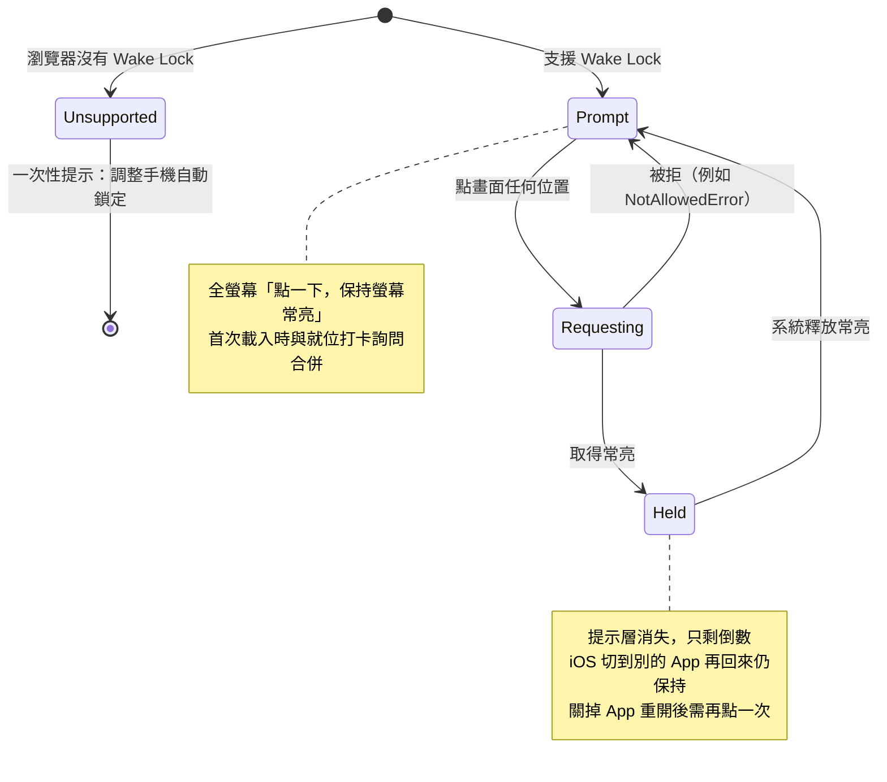

# 畫面資訊架構 (Screen Design) — P0 範圍

> 只定義「每個畫面放什麼、什麼優先、有哪些狀態」，不涉及視覺風格與技術實作。線框為示意。
> 依據：`requirements/roles-and-scenarios.md` 的使用情境、`data-model.md`、`sync-and-offline.md`、`access-control.md`。

---

## 1. 畫面清單

| 畫面 | 使用者 | 裝置 | 階段 |
| --- | --- | --- | --- |
| 總召主控台 | Master | 10~11 吋平板，橫向 | Live |
| 快速瞄畫面 | 手機在口袋、拿出來看 2 秒的角色（預設 Media、StageAV） | 手機，直向 | Draft / Live（Draft 的顯示見 4.5） |
| 免手持畫面 | 手機放桌上、雙手在忙的角色（預設 Stylist） | 手機平放、遠距離瞄 | 活動日當天的 Draft / Live |
| Rundown 編輯器 | Master（Live 時限縮，見 `access-control.md` 第 4 節） | 電腦 / 平板 | Draft |
| 角色與連結管理 | Master（Master 連結本身以復原碼換發） | 電腦 / 平板 | Draft / Live |
| 備援 Rundown 匯出 | Master、各角色（僅自己的） | 任意 | 任何 |
| 共通狀態層 | 所有人 | — | Live |
| 新人儀表板（平安儀表板） | Host | 手機 | Draft / Live |

> 畫面依使用情況分類，不依角色類型：每個角色用哪種畫面由 `Role.view` 決定，未設定時依類型的預設（`data-model.md` Role，ADR-0025）。角色類型只決定權限與內容。

> 新人儀表板只顯示「一切順利／延誤 N 分」與目前環節，不推播、不震動（`requirements/scope.md`）；延誤的算法與 5 分鐘門檻見 `data-model.md` 4.3（ADR-0022）；畫面細節於 M2a 設計時補上。

## 2. 共通設計約束

| 約束 | 規則 | 來源 |
| --- | --- | --- |
| 觸控目標 | 主要動作 ≥ 48px；總召的推進與平移按鈕更大 | 規格書 總召 |
| 暗色主題 | 預設暗色（宴會廳昏暗），亮色可選；走廊強光下仍需看得清 | README |
| 資訊密度 | 一個畫面只有一個「現在最重要的事」，其他次要 | 各角色情境 |
| 時間顯示 | 一律「HH:MM」24 小時制，倒數用「N 分」或「N:SS」 | — |
| 偏移顯示 | 平移後的 Cue 大字只顯示新時間，旁邊小字顯示原時間（如 `11:25 原 11:15`）；延後與提早不同顏色 | ADR-0028 |
| 顏色不是唯一訊號 | 狀態同時用顏色 + 圖示 + 文字，避免色盲與強光下失效 | — |
| 語言 | 繁體中文 | `requirements/scope.md` 第 3 節 |

## 3. 總召主控台

### 3.1 版面（橫向雙欄）

```
┌──────────────────────────────────────────────────────────────────────────┐
│ [連線狀態]  06/06 婚宴       現在 10:42      目前偏移 +10 分    [匯出備援] │
├───────────────────────────────────────────┬──────────────────────────────┤
│  時間軸（左，可捲動）                      │  現場面板（右）               │
│                                           │                              │
│  ✔ 09:30 新秘到場                 完成    │  ┌ 目前環節 ───────────────┐  │
│  ✔ 10:00 一進造型                 完成    │  │ 二進換裝                  │  │
│  ▶ 10:40 原10:30 二進換裝   ← 進行中       │  │ 已進行 12 分 / 預計 30 分  │  │
│  ○ 11:25 原11:15 一進預備                 │  └──────────────────────────┘  │
│  ○ 11:40 迎賓                    ⚠ 衝突   │                              │
│  ■ 12:00 開席（固定）                      │  ┌──────────────────────────┐  │
│  ○ 12:30 …                                │  │ ［ 推進：完成並開始下一個 ］│  │
│                                           │  └──────────────────────────┘  │
│                                           │  ┌──────┐┌──────┐┌────────┐   │
│                                           │  │ +5   ││ +10  ││ 自訂… │   │
│                                           │  └──────┘└──────┘└────────┘   │
│                                           │  ┌──────┐ ┌─────────────┐     │
│                                           │  │ −5   │ │ 復原上一步   │     │
│                                           │  └──────┘ └─────────────┘     │
│                                           │                              │
│                                           │  就位狀態                     │
│                                           │  ● 新秘  ● 攝影A  ○ 音控      │
│                                           │  （點選可代打卡 / 撥號）       │
└───────────────────────────────────────────┴──────────────────────────────┘
```

### 3.2 資訊優先順序
1. 目前環節與已進行時間（右欄最上方，最大）。
2. 推進按鈕：整個畫面最大、最顯眼的單一按鈕。
3. 平移快捷鍵（+5、+10、−5、自訂）。
4. 時間軸的進行位置（自動捲動到目前 Cue，下一個 Cue 保持可見）。
5. 就位狀態與衝突警告。

### 3.3 互動規則
| 操作 | 行為 |
| --- | --- |
| 推進 | 單次點擊，不需二次確認；因為有「復原上一步」兜底。按下後立即以輕微震動 / 動畫回饋。活動日當天的第一次推進同時開始活動（ADR-0020） |
| 超時提示 | 超時達 5 分鐘時，右欄目前環節下方出現「已超時 N 分，要延後後續嗎？」；點下開啟平移預覽，平移量預填為超時分鐘以 5 為單位進位（`data-model.md` 4.3，ADR-0022）。總召平移後超時歸零，提示自動消失 |
| 新增 Cue（Live） | 輸入實際開始時間、長度、標題，選擇插在哪個 Cue 之後，可指派角色（`data-model.md` 4.6，ADR-0021） |
| 時間平移 | 點「+10」→ **預覽面板**：顯示起點 Cue（預設為「下一個 Pending」）、受影響 Cue 清單（可取消勾選）、是否碰到 Fixed 衝突 → 確認才套用 |
| 平移為負值 | 已逾時的 Cue 自動排除並在預覽中標示；其餘 Cue 若會早於現在，預覽面板直接標紅並停用確認，說明是哪個 Cue（`data-model.md` 4.2） |
| 復原 | 顯示將被復原的操作描述（如「撤銷：+10 分，影響 4 個環節」），單擊執行 |
| 點時間軸 Cue | 展開詳情：各角色備註、指派的角色、可「略過」、可編輯標題與備註；Pending 的 Cue 可增減指派的角色（`access-control.md` 第 4 節） |
| 點就位狀態的角色 | 彈出：代為打卡 / 取消打卡 / 重發連結 |
| 連續誤觸保護 | 推進與平移套用後，按鈕短暫（約 1 秒）停用，防止連點 |

> 平移為什麼需要預覽而推進不需要：推進可一鍵復原且影響單一 Cue；平移會一次改動多個 Cue，且所有人都會看到，值得多一步確認。

### 3.4 狀態與錯誤
| 狀態 | 顯示 |
| --- | --- |
| 版本過期被拒絕（`sync-and-offline.md` 第 3 節） | 頂部短暫提示「畫面已更新，請重新確認」，並自動刷新 |
| 離線 | 推進與平移按鈕灰掉，旁邊顯示原因；時間軸仍可閱讀 |
| Fixed 衝突 | 該 Cue 旁 `⚠`，點開說明：「前一環節預計結束 12:08，晚於固定的 12:00」 |
| 時間倒序 | 該 Cue 旁 `⚠`，點開說明：「時間早於前一個環節 11:40」（`data-model.md` 4.2，ADR-0021） |
| 尚未開始活動（Draft） | 活動日當天：推進按鈕照常顯示，第一次推進即開始活動；非活動日：推進按鈕停用並說明「活動日當天才能開始」（ADR-0020） |

### 3.5 時間軸的 Cue 列
每列固定欄位：`狀態圖示` `有效時間（偏移）` `標題` `標記（固定 ■ / 衝突 ⚠ / 略過）`。
- 已完成的 Cue 淡化並可收合，避免佔用畫面。
- 狀態圖示：`✔` 完成、`▶` 進行中、`○` 待辦、`■` 固定、`⊘` 略過。

## 4. 快速瞄畫面

給手機放在口袋、拿出來看 2 秒就收回的角色（`Role.view = Glance`；預設 Media、StageAV）。**Token 開啟即到此畫面**，無登入、無導覽。4.2、4.4、4.5 的規則同樣適用於免手持畫面。

### 4.1 版面（手機直向）

```
┌────────────────────────┐
│ [連線狀態]     新秘 ●就位 │
├────────────────────────┤
│  目前環節                │
│  二進換裝                │
│  ─────────────────────  │
│  下一個與你有關的         │
│  ┌────────────────────┐ │
│  │ 11:25  原 11:15     │ │
│  │ 一進預備            │ │
│  │ 倒數  18 分          │ │
│  │ 備註：…             │ │
│  └────────────────────┘ │
│  稍後                    │
│   11:40 迎賓             │
│   12:00 開席             │
├────────────────────────┤
│ [ 我已就位 ]  [備援]      │
└────────────────────────┘
```

### 4.2 資訊優先順序
1. **「下一個與你有關的 Cue」卡片**置頂：時間、標題、倒數、角色專屬備註。這是 2 秒內要看懂的東西。「下一個與你有關的 Cue」= 指派給該角色、狀態為 Pending、`seq` 最小的 Cue；倒數 = 它的 `effectiveStart` − 現在。
2. 目前進行中的環節（只用一行，讓他們知道現場進度）。
3. 之後 2～3 個與自己有關的 Cue（簡短）。
4. 底部固定「我已就位」按鈕，打卡後變成「已就位 ✔（取消）」。

### 4.3 角色類型的內容差異（P0 範圍內）
| 角色類型 | 差異 |
| --- | --- |
| Stylist | 預設使用免手持畫面（第 5 節） |
| Media | 「下一個 Cue」卡片的備註欄預設展開（走位點）；P1 再加震動推播 |
| StageAV | 備註欄預設展開（音檔 / 麥克風備註）；檔名等較長內容用等寬字體 |

### 4.4 被動感知時程變更（新秘 story）
- 快照的變更提示（`sync-and-offline.md` 第 2 節）出現新的平移、**而且移動到自己的 Cue** 時，「下一個 Cue」卡片**閃爍高亮約 3 秒**並顯示橫幅「時程已更新 +10 分（原 11:15 → 現 11:25）」，數秒後收起。
- 新時間旁保留小字原時間（如 `原 11:15`），讓使用者在稍後仍知道這個 Cue 被挪過，又不會把新時間讀成「還要再加」（ADR-0028）。
- 提早（負值）用不同顏色與箭頭方向，避免與延後混淆。
- 平移沒有移動到自己的任何 Cue 時，不顯示橫幅。同一次變更的橫幅只出現一次，重新整理頁面不再出現。
- 變更提示是「新指派給你的 Cue」時，顯示橫幅「新增環節：〈標題〉（HH:MM）」，該 Cue 在清單中高亮約 3 秒（ADR-0021）。

### 4.5 活動尚未開始（Draft）
- 活動日當天：與 Live 相同，顯示「下一個與你有關的 Cue」與倒數；共通狀態層只多一條「活動尚未開始」窄條（ADR-0020）。
- 活動日以前：顯示自己的 Cue 清單與表定時間，不顯示倒數與目前環節；窄條為「活動尚未開始（M/D）」。
- 離線時依本機快照的 `eventStatus` 與裝置日期套用以上規則，所以當天沒收到 Live 快照的裝置仍會顯示倒數。

## 5. 免手持畫面

給手機平放、距離 40～60 公分、雙手不空，**只用看的**角色（`Role.view = HandsFree`；預設 Stylist，ADR-0025）。以下以新秘為例。

```
┌────────────────────────┐
│     一進造型（進行中）     │
│                        │
│          18            │  ← 極大數字（分）
│          分            │
│                        │
│   距「一進預備」11:25    │
│       原 11:15          │
└────────────────────────┘
        背景色 = 狀態
```

- **倒數目標**與角色視圖相同：下一個指派給新秘、狀態為 Pending 的 Cue 的 `effectiveStart`（見 4.2）。總召不論是延長目前環節（平移下一個 Cue）或整體延後，倒數都會跟著變。
- 最上方小字：目前進行中的 Cue 若也指派給新秘，顯示其標題與「進行中」；否則顯示「準備中」。
- 沒有下一個指派給新秘的 Pending Cue 時不顯示倒數：若還有指派給新秘的進行中 Cue，只顯示「〈標題〉進行中」；兩者都沒有才顯示「今日任務已完成」（角色視圖的卡片同樣處理）。活動尚未開始時依 4.5：活動日當天照常倒數，活動日以前改為顯示 Cue 清單；沒有任何指派的角色顯示「沒有指派給你的環節」。
- 編排提醒：新秘的交付時間點（如「一進預備」）要在 Rundown 中指派給新秘，倒數才會指向它。
- **倒數字級撐滿畫面寬度**，其他資訊都小。
- **背景色代表剩餘時間狀態**（同時有文字，不單靠顏色）：
  | 剩餘 | 背景 |
  | --- | --- |
  | > 15 分 | 暗底（平靜） |
  | 5～15 分 | 琥珀色 |
  | < 5 分 | 紅色 |
  | 已逾時 | 紅色閃爍 + 顯示「已逾時 N 分」 |
- 倒數 < 5 分時改為「分:秒」。
- 啟用螢幕常亮（Wake Lock）；不支援時顯示一次性提示，引導調整手機自動鎖定。
- **常亮提示層**：只要沒有取得常亮，就蓋一層全螢幕提示「點一下，保持螢幕常亮」，點任何位置都會申請常亮，取得後提示消失；常亮被系統釋放時提示再出現。原因：iOS 在 App 被關掉或頁面重新載入後，必須由使用者點擊才能再取得常亮（`tech-stack.md` 5.1）；切到別的 App 再回來則會保持。首次載入時的就位打卡詢問與這一下合併。
- **倒數畫面沒有任何需要點的東西**：就位打卡改在進入畫面前完成（首次載入時詢問一次），避免手上有髮蠟時點擊；唯一的例外是上述常亮提示層。
- 平移發生時：數字直接重算，背景色重新評估，並出現與快速瞄畫面相同的更新橫幅（4.4）。

常亮提示層的狀態：



## 6. Rundown 編輯器（Master，Draft）

以**表格**為主，適合在電腦上編輯：

| 欄位 | 說明 |
| --- | --- |
| 順序 | 拖曳排序（連續 `seq`） |
| 表定開始 | 時間輸入 |
| 長度（分） | 整數 |
| 標題 | 文字 |
| 固定 | 勾選（`isFixed`） |
| 指派角色 | 多選（建立 `CueRole`） |
| 角色備註 | 展開後依角色分欄填寫 |

- 「貼上 CSV」匯入（P1），先預覽、驗證後才寫入；錯誤列標紅並說明原因。
- 即時驗證：時間必須遞增（Fixed 例外時給提示）、標題必填。
- 「以某角色預覽」（P1）：切換後顯示該角色在自己的畫面看到的內容。
- 沒有「開始活動」按鈕：活動在活動日當天第一次推進時開始（ADR-0020），之後本畫面轉為 Live 的限縮模式（`access-control.md` 第 4 節）：僅標題、備註、新增、略過，以及 Pending 的 Cue 的角色指派。

## 7. 角色與連結管理

| 內容 | 說明 |
| --- | --- |
| 角色清單 | 名稱、類型、連結狀態（未發 / 有效 / 已撤銷）、`lastSeenAt`、就位狀態 |
| 動作 | 產生連結（顯示一次 + QR Code + 複製）、重發、撤銷、代打卡 |
| 權限 | Master 管理所有非 Master 角色的連結（`access-control.md` 第 2 節） |
| 復原碼入口 | 獨立入口，不需要 Master 連結：輸入復原碼後提供 `access-control.md` 第 2 節的三項操作 |
| 防誤觸 | 撤銷與重發需二次確認，說明「舊連結將立即失效，對方需要新連結」 |

## 8. 備援 Rundown 匯出

- 入口：總召主控台頂部「匯出備援」、快速瞄畫面底部「備援」、Rundown 編輯器工具列。
- 選項：全部（僅 Master）或個別角色（各角色只能匯出自己的）。
- 內容與格式依 `sync-and-offline.md` 第 9 節；畫面只需「預覽 → 列印 / 下載」兩步。
- 匯出頁頭顯示「匯出於 HH:MM，版本 N」。

## 9. 共通狀態層

所有畫面頂部固定一條窄條，依狀態變化：

| 狀態 | 窄條內容 |
| --- | --- |
| 正常 | 隱藏或只顯示小綠點 |
| 離線 | 紅色「離線中，資料更新於 HH:MM」 |
| 離線 > 5 分 | 追加「倒數可能不準」 |
| 連結失效 | 全屏「連結已失效，請向總召索取新連結」 |
| 活動未開始 | 窄條「活動尚未開始」（活動日以前附日期），不取代畫面內容（4.5，ADR-0020）；Master 在活動日當天第一次推進即開始 |
| 活動已結束 | 全屏「活動已結束，感謝你的協助」 |
| 維護中（僅 Master） | 醒目橫幅「維護中，其他角色無法連線」；其他角色此時看到的是「離線」（`tech-stack.md` 2.1「維護模式」） |

> 何時進入離線見 `sync-and-offline.md` 第 5 節；連結失效、未開始、已結束的判斷與本機資料清除規則見 `access-control.md` 3.3。
