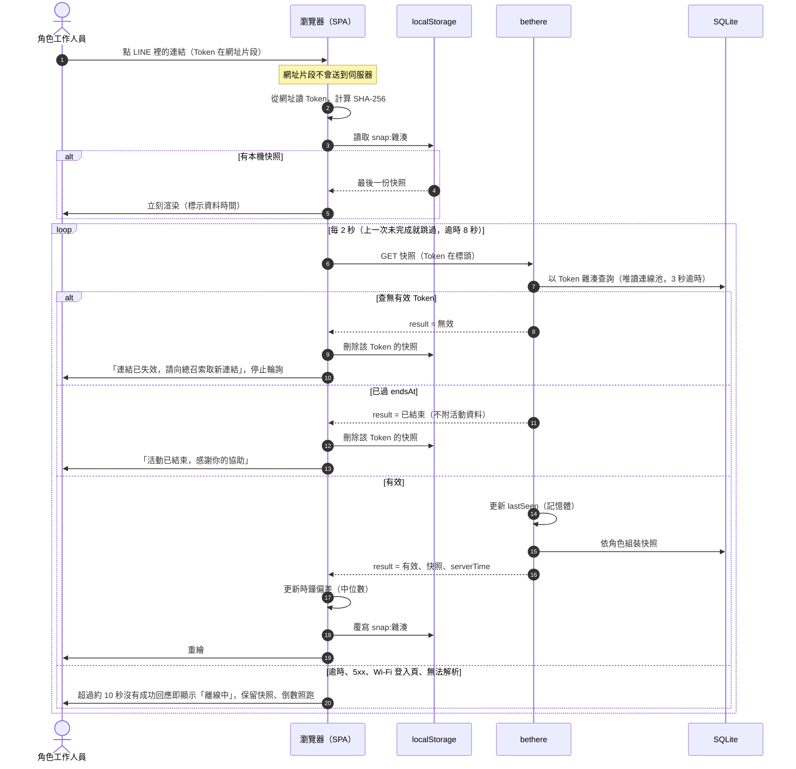
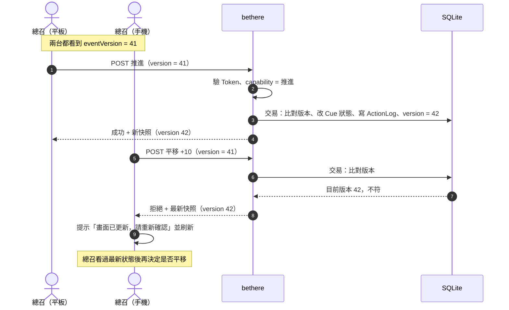
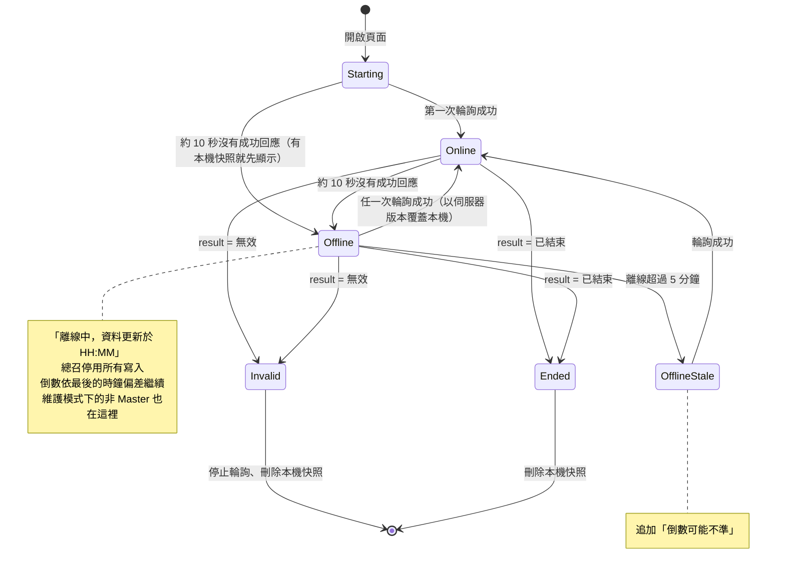

# 即時同步與離線策略 (Sync & Offline) — P0 範圍

> 邏輯設計，不綁定技術棧。對應需求：NFR-2（3 秒內更新）、NFR-3（離線唯讀）；以伺服器時間為準。理由見 ADR-0004、ADR-0005、ADR-0010。
> 資料實體見 `data-model.md`。

---

## 1. 資料流

```
總召操作 ──(API 請求 + 版本號)──► 伺服器
                                   │ 驗證 → 單一交易寫入 → version + 1
                                   ▲
                 ┌─────────────────┼─────────────────┐
                 │                 │                 │
           新秘每 2 秒輪詢    攝影每 2 秒輪詢    總召每 2 秒輪詢
               （每次：先驗 Token → 回該角色的完整快照）
```

- **讀取一律靠輪詢**，寫入一律靠 API 請求，兩條路徑分開。
- 每次輪詢都回完整快照（含 `serverTime`），客戶端不需要自己組裝狀態，同步也不依賴 `eventVersion`；它用於總召寫入的衝突檢查（第 3 節）與匯出標示。
- 以 50 台裝置估算（NFR-1 上限 50 人，同一角色可能多支手機，數量級相同），約每秒 25 個請求，負擔很小；換來的是不需要處理推送連線的驗證、斷線重連與降級狀態。
- 上一次輪詢還沒完成時跳過這一輪，請求不會重疊；單次請求超過 8 秒未回應即主動中止，算一次失敗。

開啟連結與輪詢的流程：



## 2. 快照（Snapshot）

每個角色收到的快照包含：

| 欄位 | 說明 |
| --- | --- |
| `eventVersion` | 單調遞增整數，每次狀態變動 +1 |
| `serverTime` | 產生快照時的伺服器時間（UTC） |
| `eventStatus`、`activeCueId` | 活動狀態與目前進行中的 Cue |
| `cues[]` | 該角色**可見**的 Cue：`id, seq, title, effectiveStart, durationMin, status, offsetMin, isFixed, roleNote` |
| `myCheckIn` | 自己是否已就位 |
| `shiftNotice` | 最近一次平移的摘要（`deltaMin`、時間戳），供「時程已更新」的短暫提示使用（`screen-design.md` 4.4） |
| 總召專屬 | 全部 Cue（含完整 CueRole：各角色與 `roleNote`，供備援 Rundown 匯出）、各角色就位狀態、衝突警告、最近一次可復原的操作、維護模式旗標（`tech-stack.md` 2.1「維護模式」） |

**可見性在伺服器端過濾**（ADR-0007）。不屬於該角色的 Cue 與欄位不會出現在快照裡。

> 因為快照很小（一場約數十個 Cue），回完整快照比回差異更簡單可靠：漏掉任何一次輪詢，下一次就自動補齊。

## 3. 版本與衝突

- 每個寫入請求帶上客戶端目前看到的 `eventVersion`。
- 伺服器版本與請求版本不同 → **拒絕**，回傳最新快照，畫面更新後由總召重新確認再操作。
- 只有 Master Token 能寫入 Cue 狀態；其他角色的寫入（就位打卡）彼此不衝突，不檢查版本。
- 這會讓「總召 A 剛平移、總召 B 的畫面還沒更新就按推進」被擋下，避免基於過期畫面的錯誤操作。



## 4. 時鐘與倒數

1. 每次輪詢收到回應時，客戶端計算 `clockSkew = serverTime − localNow`。從本機快取載入的快照不計算。
2. 取最近數次的中位數以降低網路延遲的影響。
3. 倒數顯示 = `effectiveStart − (localNow + clockSkew)`，客戶端每秒自行重繪。
4. 平移後，各端在下一次輪詢取得新快照，倒數自動重算。

## 5. 連線狀態與重連

- 超過約 10 秒沒有成功的輪詢回應即視為離線：總召操作按鈕停用，畫面依 `screen-design.md` 第 9 節（共通狀態層）顯示。
- 失敗與停止輪詢的判定見 `access-control.md` 3.3。
- 恢復連線後的第一次輪詢即取得最新快照，**以伺服器版本為準**覆蓋本機狀態。頁面從背景回到前景時立即輪詢一次。
- 離線期間，倒數仍依本機時鐘加上最後一次校正值繼續跑。離線超過 5 分鐘時，共通狀態層會提示倒數可能不準，因為這段時間內可能已被平移。

客戶端的連線狀態：



只有可解析且 `result` 明確為「無效」或「已結束」的回應會進入終止狀態；HTTP 401、403、5xx、逾時、會場 Wi-Fi 登入頁都只算離線。

## 6. 離線快取

- 每次收到快照就整份存入本機儲存，僅保留最近一份；依 Token 分開存放，同一台裝置開不同角色的連結不互相覆蓋。
- 收到「無效」或「已結束」時刪除該 Token 的快照（`access-control.md` 3.3）；另外，開啟頁面時刪除 `eventStatus = Live` 且最後更新（`serverTime`）超過 2 天的快照，清掉舊連結留下的資料；活動前（Draft）的快照保留，等下一次成功輪詢覆蓋。裝置端殘留只在再次開啟時清除，伺服器端於 90 天內刪除所有副本（NFR-5）。本機快照的鍵為 Token 的雜湊，不存明文 Token（`tech-stack.md` 2.2「本機快照」）。
- 不同瀏覽環境（LINE 內建瀏覽器、Safari、主畫面 Web App）的本機儲存互不共用，在某個環境第一次開啟時沒有快照可先渲染。
- 開啟頁面時：先用本機快照立刻渲染，再背景連線取得最新資料。這同時解決「進入地下室宴會廳瞬間斷網」時打開頁面是空白的問題。
- 頁面本身的靜態資源（外殼）也需要快取，離線時才打得開；做法見 `tech-stack.md` 2.2「離線外殼」。LINE 內建瀏覽器預設不支援，見 2.2「LINE 內建瀏覽器」。Service Worker 只快取靜態資源，API 請求一律不攔截、不放入快取，離線資料只走上述依 Token 分開的本機儲存。
- **總召離線時所有寫入動作停用**，並顯示原因，不排隊、不重送。

## 7. 延遲目標（NFR-2）

目標：總召操作後，95% 的終端在 3 秒內更新。

預算分配（供之後驗證）：
| 階段 | 預算 |
| --- | --- |
| 總召請求送達並完成寫入 | ≤ 400 ms |
| 等待下一次輪詢（固定間隔觸發，不從上次回應完成起算） | ≤ 2 秒（平均 1 秒） |
| 輪詢往返、產生快照並重繪 | ≤ 600 ms |

合計最壞約 3 秒、平均約 2 秒，剛好等於目標、沒有緩衝。實測若達不到，先把輪詢間隔調到 1～1.5 秒（請求量仍很小）。

## 8. 已知風險

見 `docs/README.md` 的風險清單（RISK-1、RISK-3、RISK-15、RISK-16）。

## 9. 備援 Rundown

對伺服器或網路完全失效的最後保險。

- 總召可在主控台匯出「備援 Rundown」：可列印的單頁或多頁文件，依 `scheduledStart` 排序列出所有 Cue（含 `durationMin`、`isFixed`、各角色與 `roleNote`）。
- 另可依角色各自匯出一份，只含該角色可見的 Cue。
- 匯出的是**當下的有效時間**（`effectiveStart`），並印上匯出時間與 `eventVersion`，方便辨識是否過期。
- 建議流程：活動前一晚匯出一份基準版；活動當天進場前再匯出一份最新版。
- 這是唯讀輸出，不涉及同步，因此不受離線限制。格式為列印專用網頁，由瀏覽器列印或另存 PDF（`tech-stack.md` 2.2「備援 Rundown」）。
