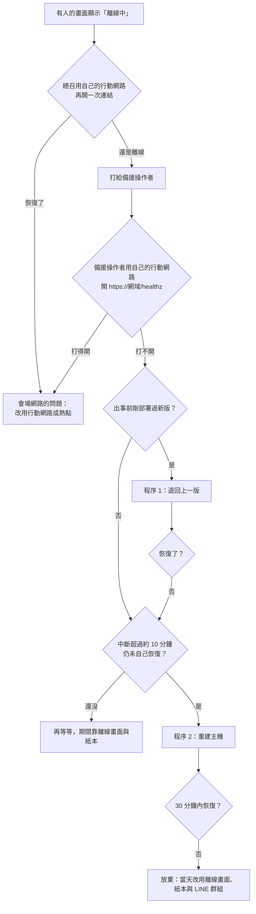

# 當天出事速查卡 (Incident Card)

> 婚禮當天出事時看這一頁。完整步驟與理由以 `operations/runbook.md` 第 2 節為準；本頁只負責「看到什麼 → 做哪一個程序」。印出來，和紙本手冊放在一起。

## 先填好（凍結時寫上，不要留空）

- 備援操作者：姓名、電話
- 開發者：電話（當天是新人，只在必要時打）
- 網域：
- 目前版本號：
- 上一版：

後兩項用 `ops/gcp/deploy.sh`（不帶版本）查得到。

## 怎麼判斷



斷線期間，每個人的手機仍看得到最後一次的流程表，倒數照跑；總召手上有紙本流程表。

## 程序 1：退回上一版

```bash
export PROJECT=$(cat ops/gcp/prod-project)
ops/gcp/deploy.sh                 # 看「previous」那一行
ops/gcp/deploy.sh <上一版>
```

- 退版之後，「previous」會變成剛退掉的那一版。**不要再照它退一次。**

## 程序 2：重建主機

只能有**一位**操作者執行，兩個人同時跑會互刪對方的主機。

1. 執行重建，版本號照紙本上的「目前版本號」：
   ```bash
   PROJECT=$(cat ops/gcp/prod-project) ops/gcp/rebuild.sh <目前版本號>
   ```
   腳本要你打出專案 ID 才會刪除舊主機。畫面上的網域和上一版要和紙本相同。
2. 腳本停下並印出 `STOPPED at:` 時，照它印的方法處理；要重跑時，照它印出的 `Run it again:` 那一整行。等候逾時不代表失敗，先照它印的 `curl` 指令看網站是否回 `maintenance`。
3. 網站回 `maintenance` 後，請**總召用總召連結**核對流程表和每個環節的狀態。
   - 資料略舊：總召直接補上。
   - 資料明顯錯誤或是空的：**不要解除維護**，當天改用離線畫面與紙本。
4. 解除維護：
   ```bash
   PROJECT=$(cat ops/gcp/prod-project) ops/gcp/maintenance.sh off
   ```
5. 用備援操作者的測試角色連結確認畫面正常，並請總召確認「維護中」橫幅消失了。（`/healthz` 在維護中也會正常，不能拿來判斷。）
6. 到 `/recover` 用復原碼**再換發一次總召連結**，傳給總召。

目標 15 分鐘內恢復。

## 什麼時候放棄

以下任一種，停手，改用離線畫面、紙本與 LINE 群組：

- 開始重建後超過 30 分鐘
- `rebuild.sh` 同一步失敗兩次
- 舊主機刪不掉，或在兩個可用區都建不出新主機（換可用區：指令最後加 `asia-east1-c`）
