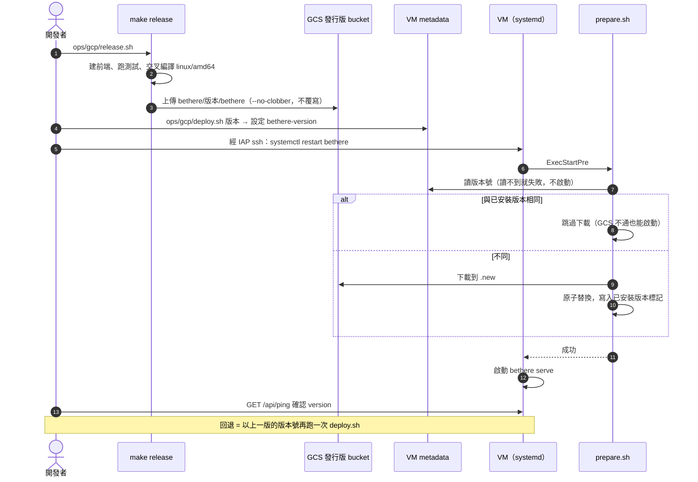
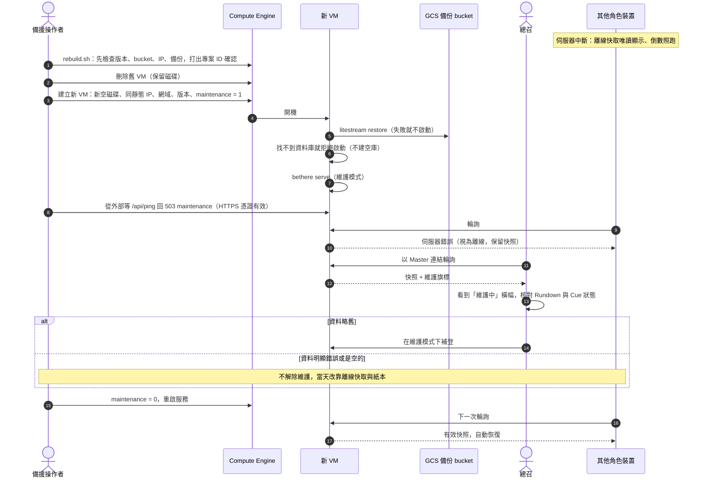

# 維運手冊 (Runbook)

> 部署、回退、故障重建與活動前後的檢查。伺服器與主機的技術選擇見 `design/tech-stack.md` 第 3 節；理由見 ADR-0009、ADR-0012、ADR-0013。
> 持續備份與開機還原已在正式專案啟用並演練通過；維護模式已實作並演練開關。故障重建（`ops/gcp/rebuild.sh`）已在暫存專案以 PO 的帳號演練通過；備援操作者本人尚未演練（RISK-4）。

---

## 1. 部署與回退

- 專案：`ops/gcp/` 的每支腳本都要先設定 `PROJECT`（正式專案是 `export PROJECT=bethere-prod-0606`），沒設就拒絕執行，開始時印出操作的專案；演練一律用暫存專案的 ID。可用區不必指定，腳本跟著 VM 實際所在的可用區。
- 部署：`ops/gcp/release.sh` 上傳發行版 → `ops/gcp/deploy.sh <版本>` 先確認發行版、Caddy 與 Litestream 都在 bucket 裡，把被換下的版本記為「上一版」（metadata `bethere-previous-version`），改 metadata、依本機的 `ops/gcp/vm-startup.sh` 重新佈置啟動腳本與服務設定，再重啟服務；最後在 VM 上確認版本，並從外部確認網站處於服務啟動時的模式（開放或維護）。`ops/gcp/deploy.sh` 不帶版本時只列出目前版本、上一版與最近上傳的版本；回退是 `ops/gcp/deploy.sh <上一版>`。上傳過的版本不一定部署過，回退一律照「上一版」，不照上傳順序。
- 維護模式（規則見 `requirements/stories.md` US-O-2）：`ops/gcp/maintenance.sh on|off|status`。`on` 開啟並重啟；`off` 解除、刪除還原標記並重啟；`status` 顯示 metadata、還原標記與服務實際的模式。三者最後都從外部確認：維護中 `/api/ping` 回 503 `maintenance`，開放時回 200。從備份還原的資料庫會一直維持維護模式，直到 `off`。維護中只能部署支援維護模式的版本，要回退到更舊的版本先 `off`。
- 重建：`ops/gcp/rebuild.sh`（第 2 節程序 2）刪掉舊 VM 後呼叫 `ops/gcp/create-vm.sh`；`create-vm.sh` 在專案已有 VM 時拒絕執行，確保恰好一台，每次都建一顆名稱不重複的新開機磁碟；新 VM 一律帶 `bethere-maintenance=1`。重建後測試服務的網域不會沿用，要再執行一次 `ops/gcp/e2e-setup.sh`。新 VM 的磁碟沒有資料庫時，服務啟動前會自動從備份 bucket 還原，並以維護模式啟動。第一次部署時以 `ops/gcp/init-db.sh` 建立空資料庫後，執行 `ops/gcp/maintenance.sh off`。
- 邀請碼（ADR-0036）：`ops/gcp/invite.sh` 在正式資料庫產生一組邀請碼，印出編號與邀請碼各一次，交給受邀的人在 `/new` 建立活動（不支援的舊版會回 `unknown command`）。記下編號給了誰：建立活動的操作紀錄只記編號。
- 系統後台（ADR-0038）：`ops/gcp/admin-link.sh` 在正式資料庫產生管理員連結，印出一次，舊的立即失效；存在自己的密碼管理工具，打開就能發邀請碼、看所有活動。懷疑外流、從備份還原後都再執行一次。
- 客服信箱（US-O-8、ADR-0037）：`ops/gcp/support-email.sh <信箱>` 設定、`ops/gcp/support-email.sh none` 清除。信箱放在專案層級的 metadata，重建 VM 也沿用。腳本不重啟服務，新的信箱從服務下次啟動起顯示：主機開著時以 `ops/gcp/deploy.sh <目前版本>` 重新部署同一版（「上一版」不變），關著時就是下次 `power.sh on`；之後開 `https://<網域>/support.json` 確認。凍結期不換信箱。由開發者（專案擁有者）執行，備援操作者沒有寫 metadata 的權限。
- 寄登入信（ADR-0040）：開一個專用的 Gmail，開啟兩步驟驗證，在 Google 帳戶的「應用程式密碼」產生一組；執行 `ops/gcp/mail.sh <Gmail 地址>`，照提示貼上應用程式密碼（不會顯示）。腳本只設定、不重啟服務，同客服信箱以 `ops/gcp/deploy.sh <目前版本>` 重新部署同一版後生效；之後在 `/login` 寄一封給自己確認。`ops/gcp/mail.sh none` 停止寄信。懷疑密碼外流、懷疑主機被入侵，以及婚後收回備援操作者權限時，都在 Google 帳戶撤銷那組應用程式密碼，再產生一組重設（能登入主機的人讀得到它，`design/access-control.md` 第 1 節）。寄信壞掉時，成員的救援見 `requirements/stories.md` US-O-12.8：經 IAP 登入主機執行 `bethere issue-login-link`，把印出的連結交給他。
- 換上寄信登入的版本時（US-CO-1.13）：所有成員要收信重新登入、重開主控台。只要 email 就能登入的期間任何人都可能進過公司，所以：
  - 開發者事先通知各公司，請每家公司核對成員清單與活動清單，多出來的成員自己移除、不認得的活動告知開發者。
  - 開發者在主機上查操作紀錄中 actor 以 `member:` 開頭的角色新增與重發，列給那場活動的公司，請他們在主控台撤銷或重發不認得的角色連結。
- 監控（US-O-7）：`ALERT_EMAIL=<信箱> ops/gcp/monitoring.sh` 建立外部探測與告警，網站打不開時約 3～5 分鐘後寄信，恢復時再寄一封。開發期主機平時關機，一律以 `ops/gcp/power.sh on|off` 開關，告警跟著開關；在 Cloud 網頁主控台直接關機，告警會一直寄信。`ops/gcp/power.sh status` 顯示主機與告警的狀態；重建或主機狀態不明時先看它，告警沒開就執行 `ops/gcp/power.sh on`（主機已開也可以，只會打開告警）。凍結期起主機一直開著，**不要**執行 `power.sh off`：它會連告警一起關掉。
- 開啟備份：`ops/gcp/setup.sh` 建立備份 bucket → `ops/gcp/release.sh` 上傳 Litestream → 備份之前建立的 VM 執行一次 `ops/gcp/backup-setup.sh`；之後建立的 VM 由 `create-vm.sh` 帶好設定。
- 活動前 7 天起凍結部署。

- 不退回到寄信登入之前的版本：那些版本只要 email 就能登入（RISK-20）。`ops/gcp/deploy.sh` 與 `rebuild.sh` 對 `bethere features` 沒有 `mail-login` 的版本拒絕執行，除非另外設定 `ALLOW_EMAIL_ONLY=1`；凍結前確認「上一版」也有 `mail-login`（第 3 節），當天照手冊退版就不會退到那之前。真的不得已退回時，換回後退回期間產生的登入連結與主控台連結自動失效（US-CO-1.13），其餘照上一項核對。
- 退回不支援婚顧公司（M4 之前）的版本時，成員的主控台連結全部顯示「連結已失效」並清掉離線快取，用主控台連結操作的人改用 Master 連結；這也是活動當天總召一律用 Master 連結的原因（`requirements/stories.md`「婚顧公司」）。

## 2. 當天的維運

> **狀態：** 腳本以假的 gcloud 在 CI 測試（`ops/gcp/test/run.sh`），並已在暫存專案以 PO 的帳號演練：重建到解除維護約 1～3 分鐘。備援操作者本人演練後再定稿。

開發者本人是新人，當天無法操作。因此：

- **指定一位備援操作者**（不是當天的總召），婚前交給他：本專案的 IAM 權限與一份紙本操作手冊。人選的條件：
  - 不在婚禮工作組裡，當天不擔任其他任務，能隨時離席操作。
  - 當天帶**已登入 gcloud 的筆電**、行動熱點，以及 Google 帳號的兩步驟驗證裝置；Cloud Shell 只是次要退路。
  - 婚前演練用同一台筆電、同一種網路進行。
- **怎麼發現故障**（ADR-0024）：
  - Uptime Check 探測 `/healthz` 與備份新鮮度端點，失敗時通知備援操作者（凍結期起）。
  - 紙本手冊寫給總召：看到「離線中」時，先用自己的行動網路開一次連結；仍然離線就打給備援操作者。備援操作者收到告警或電話後，以自己的行動網路開 `/healthz` 判斷是伺服器還是會場網路的問題。
- **權限**：`roles/compute.instanceAdmin.v1`、對 VM 服務帳號的 `roles/iam.serviceAccountUser`、`roles/iap.tunnelResourceAccessor`、`roles/compute.osAdminLogin`（供婚前還原測試；專案開啟 OS Login 時需要）、發行版 bucket 的 `roles/storage.objectViewer`（部署與重建前確認版本），以及備份 bucket 的 `roles/storage.legacyBucketReader`（只能列出檔名、讀不到內容，重建前確認有備份）。這些權限可以改 VM 的啟動腳本並登入主機，**等同完全接管**，因此以 IAM 條件設定**到期時間**（婚禮後數天自動失效），並列入 `access-control.md` 的威脅表。
- 操作手冊只涵蓋兩件事，**由他本人在婚前演練一次**：
  1. **退回上一個發行版**：`ops/gcp/deploy.sh` 看「previous」那一行，再 `ops/gcp/deploy.sh <上一版>`。退版之後「previous」變成剛退掉的那版，不要再照它退一次。
  2. **VM 或磁碟故障**（啟動門檻：服務中斷超過約 10 分鐘仍未自行恢復；放棄條件：開始後超過 30 分鐘、`rebuild.sh` 同一步失敗兩次、舊 VM 刪不掉（靜態 IP 仍被佔用）或在兩個可用區都建不出新的 e2-micro，就停止並改靠離線快取與紙本）：
     1. 執行 `PROJECT=bethere-prod-0606 ops/gcp/rebuild.sh <紙本上記錄的目前版本號> [可用區]`。版本號必須支援維護模式，否則還原後服務不會啟動。可用區省略時沿用舊 VM 的（沒有舊 VM 時是 `asia-east1-b`）；舊 VM 所在的可用區故障時，改指定 `asia-east1` 的另一個（例如 `asia-east1-c`）。腳本依序：
        - **先檢查、不刪任何東西**：版本號格式；發行版、Caddy 與 Litestream 都在 bucket 裡；靜態 IP 存在；可用區在 `asia-east1`、確實存在且有 e2-micro；備份 bucket 裡有備份。殼層裡殘留的 `ZONE` 不算數，只有指令的第二個參數能換可用區。從舊 VM 讀出網域與上一版；舊 VM 已經不在時，照紙本另外設定 `DOMAIN` 與 `PREVIOUS_VERSION`（例如 `DOMAIN=34-80-7-111.sslip.io PREVIOUS_VERSION=c406027-20261027032903`；沒有上一版時寫 `PREVIOUS_VERSION=none`），網域只寫主機名稱，不加 `https://` 或斜線。殼層裡殘留的 `DOMAIN` 或 `PREVIOUS_VERSION` 與舊 VM 的不同時，腳本拒絕執行；照紙本給的上一版必須在發行版 bucket 裡；舊 VM 記錄的上一版若已從 bucket 刪掉，腳本提出警告，重建後不記上一版。
        - 列出要刪除的 VM（名稱、可用區、狀態、建立時間）與要用的網域、上一版，要你打出專案 ID 才繼續。看到的 VM 若是剛恢復正常、已經解除維護的那台，不要確認；沒有舊 VM 時，核對畫面上的網域與上一版和紙本相同。
        - 刪除所有 VM（保留磁碟，之後不再掛載）→ 建立恰好一台新 VM：新的、名稱不重複的空開機磁碟，沿用靜態 IP、網域與上一版，`bethere-maintenance=1`；啟動腳本自動從 GCS 還原。
        - 從外部等 `https://<網域>/api/ping` 回 503 `maintenance`，最多 10 分鐘：回得到就表示開機、還原、憑證與服務都好了，且停在維護模式。這不保證資料是最新的，資料由步驟 5 的總召核對。
        - 再等到 ssh 連得上新 VM，最多 2 分鐘（網站回應後，IAP 可能還要約一分鐘才連得到），因為步驟 6 的解除維護要用 ssh。
        - 印出花了幾分鐘、接下來的步驟，以及沒有掛在任何 VM 上的磁碟（婚後依第 4 節刪除）。
     2. 任何一步失敗，腳本停下並印出「STOPPED at: 哪一步、已經幾分鐘」與該怎麼做：檢查失敗時這次執行什麼都沒刪，修正後重跑；刪除或建立 VM 失敗時，照它印出的「Run it again:」整行指令重跑，裡面已帶好專案、網域、上一版、版本號與可用區（建立失敗時可把最後的可用區換成另一個；換版本號重跑會把沒起來的那版記成上一版）；等候逾時時，新 VM 可能只是還沒好，先等幾分鐘，照它印出的 `curl` 指令從外部看（不經 ssh；`maintenance.sh status` 會先用 ssh，新 VM 剛起來時可能連不上，不能當作起不來的證據），回 `maintenance` 就是好了，確定起不來才重跑（重跑會刪掉這台、再申請一次憑證）；只停在等 ssh 時網站已經好了，不要重跑：照樣做步驟 5，幾分鐘後再做步驟 6；仍然連不上時，看它印出的錯誤，檢查 IAP 權限與防火牆。自己記下失敗次數：同一步失敗第二次，或從開始已超過 30 分鐘，就放棄。
     3. 只能有一位操作者執行：兩個人同時重跑，會互相刪掉對方剛建好的 VM。
     4. 每次重建都會向 Let's Encrypt 申請一次憑證，同一個網域一週最多 5 次；演練不要對同一個網域連續重建。
     5. 請總召用 Master 連結確認 Rundown 與 Cue 狀態是最新的，並在角色與連結管理畫面確認各角色的連結狀態（未發／有效／已撤銷）。此時其他角色仍被擋、`lastSeenAt` 已歸零，「最近有人在用」必定是空的，不必核對。
        - 資料略舊：總召在維護模式下直接補登（Master 可寫入）。
        - 備份時間點之後若曾以 `reset-recovery-code` 重設復原碼，還原後外流的舊碼又會有效，備援操作者手上的新碼反而無效：先由開發者再重設一次，憑證用總召手上的 Master 連結（還原後仍有效時），否則用重設前的舊紙本碼；新碼交給備援操作者，再做下一步。兩者都不能用時同 RISK-19（`README.md`）。
        - 婚顧公司：服務啟動時已刪除所有成員的登入連結、登入信連結與主控台連結（`requirements/stories.md` US-O-12.5），成員要重新登入、重開主控台，開著的主控台會收到「連結已失效」。`maintenance.sh status` 提示「成員連結尚未清除」時（服務日誌有 `member-reset` 開頭的錯誤，或安裝的版本不支援），公司端點不開放，婚禮照常；之後以支援的版本重新啟動服務即可，不必擋著解除維護。開發者通知所有公司：備份時間點之後移除的成員又回到公司，請核對，由開發者以 `bethere remove-member` 再移除；備份時間點之後曾以復原碼換發總召連結的，請在 `/recover` 再換發一次；備份時間點之後在公司頁面建立的活動不見了，要重建。
        - 開發者以 `ops/gcp/admin-link.sh` 重新產生一次管理員連結：備份時間點之後若曾因外流重新產生，還原後被取代的舊連結又會有效。
        - 一律由備援操作者以復原碼在 `/recover` **再換發一次** Master 連結，傳給總召：備份時間點之後若曾換發，還原後舊的 Master 連結又會有效。
        - 以邀請碼建立的活動沒有備援操作者：開發者通知那些建立者，若備份時間點之後曾以復原碼換發總召連結，請自己在 `/recover` 再換發一次。
        - 備份時間點之後用掉的邀請碼又能用、之後才產生的邀請碼不見了，那段時間以邀請碼建立的活動也不在了：請那些建立者用原本的邀請碼重建，或發新的邀請碼。
        - 總召核對備份時間點之後重發或新增的連結：還原後這些連結不存在，解除維護時那些裝置會收到「連結已失效」並清除資料，要重發。
        - 資料明顯錯誤或是空的：**不解除維護模式**，當天改靠離線快取與紙本。
     6. 執行 `PROJECT=bethere-prod-0606 ops/gcp/maintenance.sh off`（改 metadata、刪除還原標記並重啟，最後從外部確認已開放）；各端短暫離線後自動恢復。以備援操作者專用的**測試角色連結**確認 API 正常回應，並請總召確認維護橫幅已消失（`/healthz` 在維護模式下也正常，不能用來判斷）。目標 15 分鐘內恢復。
- 紙本手冊：抄下本節程序 1、2 的指令，以及凍結時的「目前版本號」「上一版」與網域（`ops/gcp/deploy.sh` 不帶版本即可看到前兩者）；備援操作者的筆電上的程式碼固定在凍結時的版本（`deploy.sh` 會用筆電上的 `ops/gcp/vm-startup.sh` 重新佈置正式 VM）。
- **演練**在另一個暫存專案進行（同一套腳本、另一組 bucket 與 IAM、另一個子網域），於凍結期之前完成，不碰正式專案。以**備援操作者本人的帳號與權限**執行，確認權限足夠。必做項目：
  - 「空磁碟 → 資料回來」。
  - 「空磁碟加錯誤的 bucket 名稱或拿掉服務帳號權限 → 服務不啟動」（資料庫已存在時，備份失敗不會讓服務停下，所以必須在空磁碟上測）。
  - 完整走一次「程序 2 恢復 → 解除維護 → 程序 1 回退」，全程恰好 1 台 VM，且回退後確實換成上一版。
  - 計時：從決定重建（服務已中斷約 10 分鐘的啟動門檻之後）到解除維護，目標 15 分鐘；記下每一步花的時間與申請憑證的次數。
  - 重開 VM 時暫時拿掉發行版 bucket 的讀取權：本機已是同一版本，服務仍應正常啟動。
  - 一般重開機後，服務不需人工介入就自行起來。
  - 資料遺失量（NFR-9）：以 Master 連結推進一次，立刻（10 秒內）停掉 VM，依程序 2 還原，確認這次推進還在。
  - 告警：停掉服務，確認備援操作者的手機收到 Uptime Check 的推播與簡訊。
  - 確認 `BETHERE_INIT` 不在 metadata 中（「`BETHERE_INIT` 未移除 → 不啟動」由自動測試涵蓋）；確認 `litestream replicate` 在資料庫檔尚未存在時的行為（若它先建了空檔，`BETHERE_INIT` 會因檔案已存在而拒絕，首次部署要調整順序）；確認建立資料庫的使用者、`bethere` 服務與 Litestream 是同一個使用者（資料庫檔權限為 0600）；確認新 VM 上 Caddy 能在數十秒內取得憑證。
- 婚前在正式活動中替備援操作者建立一個測試角色，供步驟 6 驗證。
- **整個 `asia-east1` 區域無法使用時不切換區域**：當天靠離線快取與紙本備援 Rundown 撐住。這是刻意接受的風險（單一可用區故障可在同區域另一個可用區重建）。
- 還原期間各端同樣靠離線快取與紙本撐住。
- 若找不到合適的備援操作者，就明確接受「當天只剩離線快取與紙本」。

程序 2（VM 或磁碟故障）的流程：

## 3. 婚前檢查

- 決定日（2027-04-15）前，處理不屬於系統、但任何一項出事都會全場失效的項目（RISK-17）：
  - GCP 帳單：付款用的信用卡效期涵蓋到 2027-09；設定預算告警。
  - 網域：續約到婚禮後一年以上，開啟 registrar lock。
  - 帳號：另開一個只屬於開發者本人的 Google 帳號，設為專案的第二位 Owner，以實體安全金鑰或印出的備用碼保護，平時不登入、不交給任何人；只在主帳號被鎖時使用。不把備援操作者設為 Owner，以免他的權限失去到期時間。
- 凍結期開始前：以 `ops/gcp/deploy.sh` 確認目前版本與「上一版」都支援寄信登入（`mail-login`）；上一版不支援時，再部署一次目前的版本，讓上一版也是它。
- 凍結期開始時（活動前 7 天）：以 `ALERT_EMAIL=<備援操作者的信箱> ops/gcp/monitoring.sh` 把告警改為只寄給備援操作者，再在 Cloud 主控台替這個告警加上他的手機推播與簡訊通道（腳本只管 email；加完之後不要再執行 `monitoring.sh`，它會重建告警、拿掉這些通道），再在 Cloud 主控台直接關機（不用 `power.sh`，告警才會開著），等到收到告警信（約 3～5 分鐘），然後以 `ops/gcp/power.sh on` 開回，確認收到恢復通知（ADR-0024）。
- 活動前一晚：總召在電腦上匯出並列印全部角色的紙本備援 Rundown。
- 活動前一天：備援操作者經 IAP 登入正式 VM，從 GCS 實際還原一次到暫存檔，確認備份可用且內容是最新的（同時涵蓋「資料庫閒置時是否仍有可還原的快照」），**驗完立即刪除暫存檔**；確認備份 bucket 的 soft delete 仍為關閉。
- 活動前一天：請所有工作人員用系統瀏覽器開一次連結，讓外殼與快照存到裝置上（iOS Safari 對 7 天沒互動的網站會清除本機資料與 Service Worker，太早開啟的快取可能已不在）。

## 4. 婚後收尾

由開發者本人執行，排進行事曆：

- 婚後數天內：把告警改回只通知開發者；確認備援操作者的 IAM 權限已到期失效；以例行的還原流程**重建一次 VM**（權限期間若被留下 ssh 金鑰、cron 等後門，不會隨權限到期而消失）；刪除**所有**不再使用的磁碟，以及演練用的暫存專案。
- 事後紀錄匯出在 `endsAt` 後 80 天內完成。
- VM 常駐到每日排程完成刪除（`endsAt` 後第 81 天）。若要提早停機省錢，改為在停機前手動刪除 VM、所有磁碟與備份 bucket。
- 每日刪除在服務啟動時執行一次，之後每 24 小時一次；每次在服務日誌（`journalctl -u bethere`）留下以 `purge` 開頭的紀錄：成功時記錄當時的時鐘、刪除的活動 id 與筆數，失敗時記錄錯誤。主機時鐘落在 2000～2199 年以外時不刪並記錄錯誤。刪錯時只能在 72 小時內以 Litestream 還原到刪除前的時間點（尚未演練），還原前先建立 `/var/lib/bethere/maintenance.forced` 與 `/var/lib/bethere/member-reset.pending`（之後照第 2 節程序 2 的步驟 5、6 解除維護；成員的連結在服務啟動時刪除，`design/api.md` 10.2）；而且要先修正原因（例如主機時鐘），否則服務一啟動又會刪掉；照規則到期的活動還原回來也會再被刪，要留下只能改程式。
- 第 85 天驗收：確認活動已從資料庫刪除、備份 bucket 上只剩刪除後產生的快照；未達成就手動刪除 VM、磁碟與 bucket。
