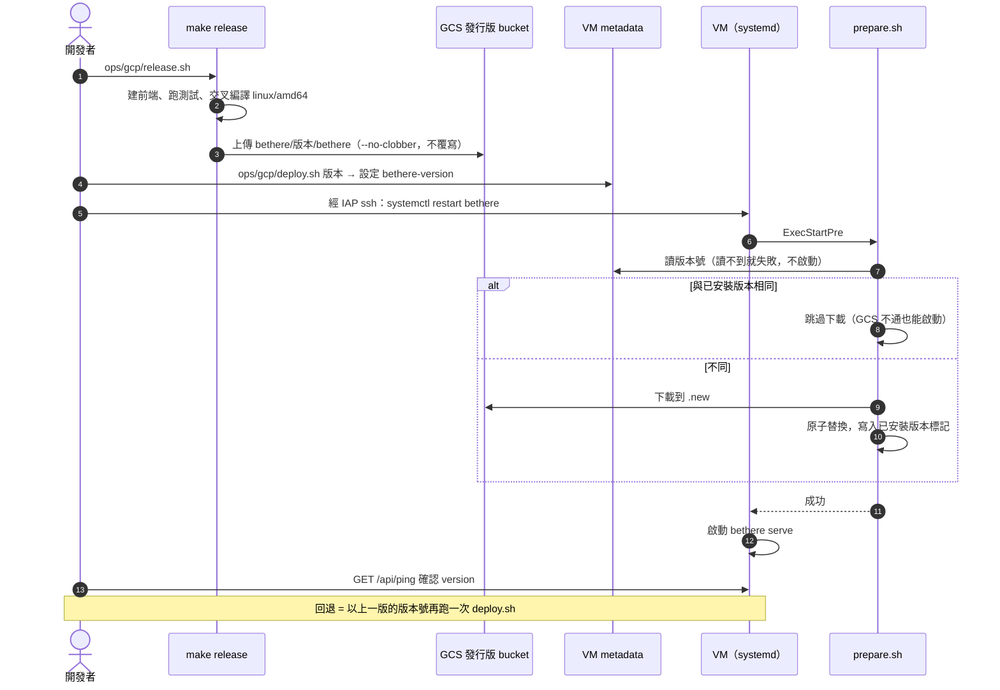
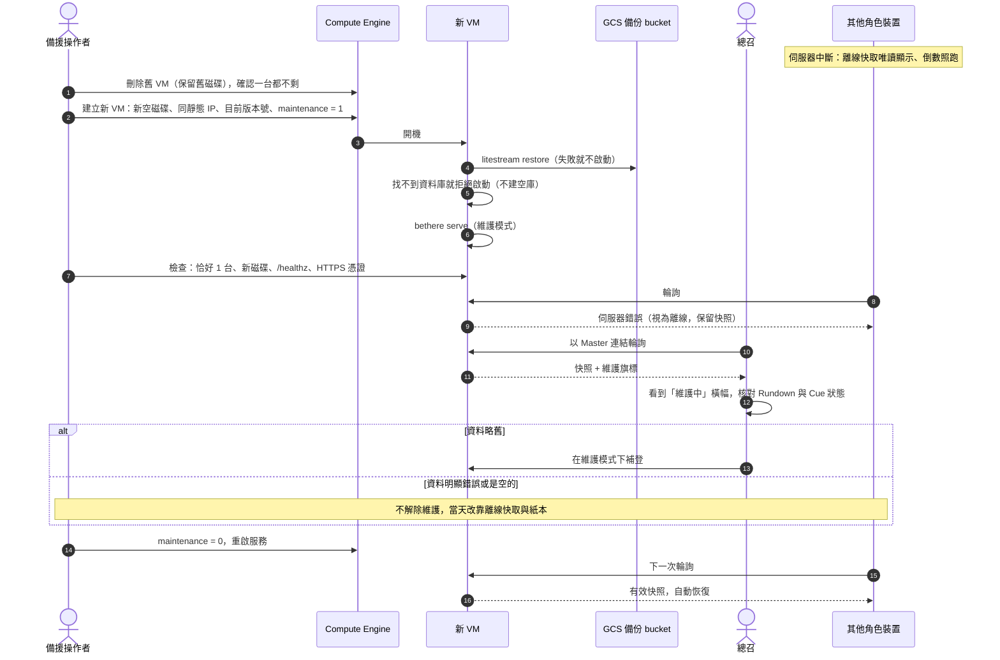

# 維運手冊 (Runbook)

> 部署、回退、故障重建與活動前後的檢查。伺服器與主機的技術選擇見 `design/tech-stack.md` 第 3 節；理由見 ADR-0009、ADR-0012、ADR-0013。
> 持續備份與開機還原已在正式專案啟用並演練通過。維護模式、刪除舊 VM 的腳本、`create-vm.sh` 帶 `bethere-maintenance` 都還沒有；第 2 節因此仍是要求草案（RISK-4、RISK-9）。

---

## 1. 部署與回退

- 部署：`ops/gcp/release.sh` 上傳發行版 → `ops/gcp/deploy.sh <版本>` 改 metadata 並重啟服務。回退是同一個指令帶上一版。
- 重建：`ops/gcp/create-vm.sh` 在專案已有 VM 時拒絕執行，確保恰好一台。新 VM 的磁碟沒有資料庫時，服務啟動前會自動從備份 bucket 還原。
- 開啟備份：`ops/gcp/setup.sh` 建立備份 bucket → `ops/gcp/release.sh` 上傳 Litestream → 備份之前建立的 VM 執行一次 `ops/gcp/backup-setup.sh`；之後建立的 VM 由 `create-vm.sh` 帶好設定。
- 活動前 7 天起凍結部署。

## 2. 當天的維運

> **狀態：要求草案。** 除了持續備份與開機還原（已實作並演練），本節列出操作手冊必須滿足的要求，不是可照抄的指令。gcloud 與啟動腳本的實際行為無法在紙上確認；實作時寫成腳本，在暫存專案演練驗證後再定稿，並對腳本與演練結果另行抗辯審查。

開發者本人是新人，當天無法操作。因此：

- **指定一位備援操作者**（不是當天的總召），婚前交給他：本專案的 IAM 權限與一份紙本操作手冊。人選的條件：
  - 不在婚禮工作組裡，當天不擔任其他任務，能隨時離席操作。
  - 當天帶**已登入 gcloud 的筆電**、行動熱點，以及 Google 帳號的兩步驟驗證裝置；Cloud Shell 只是次要退路。
  - 婚前演練用同一台筆電、同一種網路進行。
- **怎麼發現故障**（ADR-0024）：
  - Uptime Check 探測 `/healthz` 與備份新鮮度端點，失敗時通知備援操作者（凍結期起）。
  - 紙本手冊寫給總召：看到「離線中」時，先用自己的行動網路開一次連結；仍然離線就打給備援操作者。備援操作者收到告警或電話後，以自己的行動網路開 `/healthz` 判斷是伺服器還是會場網路的問題。
- **權限**：`roles/compute.instanceAdmin.v1`、對 VM 服務帳號的 `roles/iam.serviceAccountUser`、`roles/iap.tunnelResourceAccessor` 與 `roles/compute.osAdminLogin`（供婚前還原測試；專案開啟 OS Login 時需要）。這些權限可以改 VM 的啟動腳本並登入主機，**等同完全接管**，因此以 IAM 條件設定**到期時間**（婚禮後數天自動失效），並列入 `access-control.md` 的威脅表。
- 操作手冊只涵蓋兩件事，**由他本人在婚前演練一次**：
  1. **退回上一個發行版**：把 metadata 的版本號改回上一版並重啟服務。
  2. **VM 或磁碟故障**（啟動門檻：服務中斷超過約 10 分鐘仍未自行恢復；放棄條件：開始後超過 30 分鐘、步驟 2～3 失敗兩次、舊 VM 刪不掉（靜態 IP 仍被佔用）或建不出新的 e2-micro，就停止並改靠離線快取與紙本）：
     1. 刪除舊 VM（保留舊磁碟，之後不再掛載），確認專案裡一台 VM 都不剩。
     2. 以預先寫好的建立指令，在 `asia-east1` 的任一可用區建立恰好一台新 VM：**新的空開機磁碟**、沿用靜態 IP、metadata 帶**已記錄的目前版本號**與 `bethere-maintenance=1`；啟動腳本自動從 GCS 還原。
     3. 檢查點：專案裡恰好 1 台 VM、使用的是新磁碟、`/healthz` 正常、HTTPS 憑證有效。不符時刪除這台 VM，回到步驟 2。
     4. 請總召用 Master 連結確認 Rundown 與 Cue 狀態是最新的，並在角色與連結管理畫面確認各角色的連結狀態（未發／有效／已撤銷）。此時其他角色仍被擋、`lastSeenAt` 已歸零，「最近有人在用」必定是空的，不必核對。
        - 資料略舊：總召在維護模式下直接補登（Master 可寫入）；故障前若曾以復原碼換發 Master，再換發一次。
        - 資料明顯錯誤或是空的：**不解除維護模式**，當天改靠離線快取與紙本。
     5. 把 metadata 改為 `bethere-maintenance=0` 並重啟服務（開啟與解除用同一種機制，服務啟動時會重讀 metadata）；各端短暫離線後自動恢復。以備援操作者專用的**測試角色連結**確認 API 正常回應，並請總召確認維護橫幅已消失（`/healthz` 在維護模式下也正常，不能用來判斷）。目標 15 分鐘內恢復。
- 以上步驟在實作時寫成腳本（版本號、可用區參數），並抄進紙本手冊。
- **演練**在另一個暫存專案進行（同一套腳本、另一組 bucket 與 IAM、另一個子網域），於凍結期之前完成，不碰正式專案。以**備援操作者本人的帳號與權限**執行，確認權限足夠。必做項目：
  - 「空磁碟 → 資料回來」。
  - 「空磁碟加錯誤的 bucket 名稱或拿掉服務帳號權限 → 服務不啟動」（資料庫已存在時，備份失敗不會讓服務停下，所以必須在空磁碟上測）。
  - 完整走一次「程序 2 恢復 → 解除維護 → 程序 1 回退」，全程恰好 1 台 VM、磁碟不變，且回退後確實換成上一版。
  - 重開 VM 時暫時拿掉發行版 bucket 的讀取權：本機已是同一版本，服務仍應正常啟動。
  - 一般重開機後，服務不需人工介入就自行起來。
  - 資料遺失量（NFR-9）：以 Master 連結推進一次，立刻（10 秒內）停掉 VM，依程序 2 還原，確認這次推進還在。
  - 告警：停掉服務，確認備援操作者的手機收到 Uptime Check 的推播與簡訊。
  - 確認 `BETHERE_INIT` 不在 metadata 中（「`BETHERE_INIT` 未移除 → 不啟動」由自動測試涵蓋）；確認 `litestream replicate` 在資料庫檔尚未存在時的行為（若它先建了空檔，`BETHERE_INIT` 會因檔案已存在而拒絕，首次部署要調整順序）；確認建立資料庫的使用者、`bethere` 服務與 Litestream 是同一個使用者（資料庫檔權限為 0600）；確認新 VM 上 Caddy 能在數十秒內取得憑證。
- 婚前在正式活動中替備援操作者建立一個測試角色，供步驟 5 驗證。
- **整個 `asia-east1` 區域無法使用時不切換區域**：當天靠離線快取與紙本備援 Rundown 撐住。這是刻意接受的風險（單一可用區故障可在同區域另一個可用區重建）。
- 還原期間各端同樣靠離線快取與紙本撐住。
- 若找不到合適的備援操作者，就明確接受「當天只剩離線快取與紙本」。

程序 2（VM 或磁碟故障）的流程：

## 3. 婚前檢查

- 決定日（2027-04-15）前，處理不屬於系統、但任何一項出事都會全場失效的項目（RISK-17）：
  - GCP 帳單：付款用的信用卡效期涵蓋到 2027-09；設定預算告警。
  - 網域：續約到婚禮後一年以上，開啟 registrar lock。
  - 帳號：另開一個只屬於開發者本人的 Google 帳號，設為專案的第二位 Owner，以實體安全金鑰或印出的備用碼保護，平時不登入、不交給任何人；只在主帳號被鎖時使用。不把備援操作者設為 Owner，以免他的權限失去到期時間。
- 凍結期開始時（活動前 7 天）：把 Uptime Check 的告警改為只通知備援操作者（手機推播加簡訊），並觸發一次測試告警確認收得到（ADR-0024）。
- 活動前一晚：總召在電腦上匯出並列印全部角色的紙本備援 Rundown。
- 活動前一天：備援操作者經 IAP 登入正式 VM，從 GCS 實際還原一次到暫存檔，確認備份可用且內容是最新的（同時涵蓋「資料庫閒置時是否仍有可還原的快照」），**驗完立即刪除暫存檔**；確認備份 bucket 的 soft delete 仍為關閉。
- 活動前一天：請所有工作人員用系統瀏覽器開一次連結，讓外殼與快照存到裝置上（iOS Safari 對 7 天沒互動的網站會清除本機資料與 Service Worker，太早開啟的快取可能已不在）。

## 4. 婚後收尾

由開發者本人執行，排進行事曆：

- 婚後數天內：把告警改回只通知開發者；確認備援操作者的 IAM 權限已到期失效；以例行的還原流程**重建一次 VM**（權限期間若被留下 ssh 金鑰、cron 等後門，不會隨權限到期而消失）；刪除**所有**不再使用的磁碟，以及演練用的暫存專案。
- 事後紀錄匯出在 `endsAt` 後 80 天內完成。
- VM 常駐到每日排程完成刪除（`endsAt` 後第 81 天）。若要提早停機省錢，改為在停機前手動刪除 VM、所有磁碟與備份 bucket。
- 每日刪除在服務啟動時執行一次，之後每 24 小時一次；每次在服務日誌（`journalctl -u bethere`）留下以 `purge` 開頭的紀錄：成功時記錄當時的時鐘、刪除的活動 id 與筆數，失敗時記錄錯誤。主機時鐘落在 2000～2199 年以外時不刪並記錄錯誤。刪錯時只能在 72 小時內以 Litestream 還原到刪除前的時間點（尚未演練），而且要先修正原因（例如主機時鐘），否則服務一啟動又會刪掉；照規則到期的活動還原回來也會再被刪，要留下只能改程式。
- 第 85 天驗收：確認活動已從資料庫刪除、備份 bucket 上只剩刪除後產生的快照；未達成就手動刪除 VM、磁碟與 bucket。
