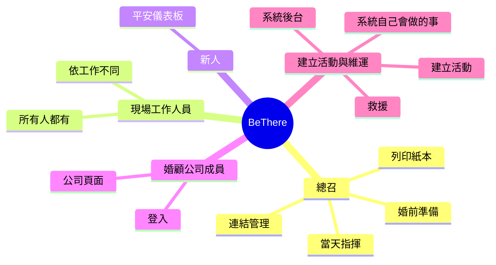

# 功能樹 (Feature Tree)

> 照「誰在用」整理的功能導覽，附上每個畫面的網址。功能的正本與完成狀態見 `requirements/scope.md` 第 2 節；畫面內容見 `design/screen-design.md`；路由規則見 `design/tech-stack.md`「路由」。
> 本文件只列已完成的功能；還沒做的見 `requirements/scope.md` 的 P1、P2 與「未排入」。

---

## 1. 總覽

## 2. 網址一覽

網址前面接主機位址；在本機執行時是 `http://127.0.0.1:8080`。`#t=` 後面是每個人專屬的連結（Token）。同一個 `/`，依連結是誰的，顯示總召主控台、工作人員畫面或新人儀表板。

| 網址 | 畫面 |
| --- | --- |
| `/#t=<個人連結>` | 總召主控台、快速瞄畫面、免手持畫面或平安儀表板（依連結的角色） |
| `/` | 沒帶連結：提示找不到連結，並連到「用邀請碼建立」 |
| `/print#t=<個人連結>` | 列印紙本流程表 |
| `/new` | 用邀請碼建立活動 |
| `/recover` | 用復原碼換發總召連結 |
| `/login` | 婚顧公司成員登入（寄登入信） |
| `/login#t=<信裡的連結>` | 點登入信的連結完成登入 |
| `/company#t=…` | 婚顧公司頁面（登入後自動帶入） |
| `/admin#t=<管理員連結>` | 系統後台 |

## 3. 總召

現場指揮，唯一能改流程的人，用平板。畫面：總召主控台，`/#t=<總召連結>`。

- **婚前準備**
  - 準備清單：提醒還有哪些事沒做
  - 編輯流程表：改時間、長度、順序、刪除、指派給誰、寫備註
  - 貼上 CSV 匯入整份流程表
  - 新增工作人員，產生每個人專屬的連結與 QR Code
  - 新增工作人員時選工作：一般、領班、機動組、迎賓、禮金
  - 用某個工作人員的身分預覽他的畫面
  - 匯入賓客名單、設定禮金交接檢核表
- **當天指揮**
  - 時間軸：看到所有環節與目前進行到哪
  - 一個大按鈕推進到下一個環節；按錯可以復原
  - 整體時間往後或往前挪 N 分鐘，挪之前先試算結果
  - 某環節超時 5 分鐘時，提醒要不要挪時間
  - 略過某個環節
  - 臨時新增環節、改派給別人，被指派的人會收到提示
  - 看誰已經就位，也能替人打卡
  - 現場工作：管理任務、替賓客報到、勾禮金檢核
- **連結管理**
  - 看每個人的連結有沒有用過、最後上線時間
  - 撤銷或重發某人的連結（要確認兩次）
- **列印紙本**
  - 列印整份紙本流程表：`/print#t=<總召連結>`

## 4. 現場工作人員

點自己的連結就能用，不用註冊，用手機。網址：`/#t=<個人連結>`。

- **所有人都有**
  - 只看到跟自己有關的環節與倒數
  - 時間被挪動時，自己的下一個環節會閃一下並顯示原時間與新時間
  - 看到現在「一切順利」還是「延誤 N 分」
  - 需要的話自己打卡表示已就位
  - 斷網時還是能看最後一次的內容
  - 列印自己的紙本流程表：`/print#t=<個人連結>`
- **依工作不同**
  - 新秘：手機放桌上，只顯示超大字倒數，螢幕不會暗（免手持畫面）
  - 攝影：下一個環節的走位備註直接展開（快速瞄畫面）
  - 音控：音檔、麥克風備註直接展開（快速瞄畫面）
  - 主持：看得到整體延誤多少（快速瞄畫面）
  - 領班：對自己的環節按「收到」
  - 機動組：從任務池認領任務、完成或放回
  - 迎賓：一鍵呼叫機動組；搜尋賓客、看桌號、幫他報到
  - 禮金：逐項勾選交接檢核表

## 5. 新人

新郎新娘。畫面：平安儀表板，`/#t=<新人連結>`。

- 只顯示「一切順利」或「延誤 N 分」，加上現在進行到哪個環節
- 不推播、不震動

## 6. 婚顧公司成員

用公司帳號管理多場婚禮。

- 輸入 email 寄登入信：`/login`
- 點信裡的連結登入：`/login#t=<信裡的連結>`
- 看公司的所有活動、新增活動：`/company#t=…`
- 從公司頁面打開某場活動的總召主控台：`/#t=<主控台連結>`
- 加入或移除同事：`/company#t=…`

## 7. 建立活動與維運

- **建立活動**
  - 拿到邀請碼的人自己建立活動，拿到總召連結與復原碼：`/new`
  - 開發者以指令建立活動、角色、匯入流程表（沒有網址，見 `operations/runbook.md`）
- **救援**
  - 總召連結弄丟時，用復原碼換一條新的：`/recover`
  - 復原碼也弄丟時，開發者以 `reset-recovery-code` 指令重設
  - 登入信寄不出去時，開發者以 `issue-login-link` 指令直接給登入連結
- **系統後台**：`/admin#t=<管理員連結>`
  - 發邀請碼
  - 看所有活動
  - 建立婚顧公司與第一位成員
- **系統自己會做的事**
  - 持續備份；主機重開時自動還原
  - 每天刪除已結束、過了保留期的活動
  - 維護模式：還原後先讓總召核對，再對全場開放
